# LogisticsEngine — Documentazione di progettazione

Panoramica dell'architettura, dei servizi, degli algoritmi e della libreria di base del
progetto **LogisticsEngine**, un sistema didattico di gestione logistica costruito con
**Domain-Driven Design (DDD)** e **Clean Architecture** su **.NET 10**.

> I diagrammi sono in [Mermaid](https://mermaid.js.org/): GitHub li renderizza automaticamente.

---

## 1. Visione d'insieme

Il sistema gestisce **spedizioni, ordini, hub, zone e strade**, ed espone come funzionalità
di prima classe alcune **strutture dati e algoritmi** (code, pile, alberi, grafi con cammini
minimi). È composto da:

- un **backend** .NET a più layer (Domain, Application, Infrastructure, API) con test automatici e pipeline CI;
- un **frontend** Vue 3 (SPA) che consuma l'API via AJAX e **visualizza graficamente** grafi, alberi e code.

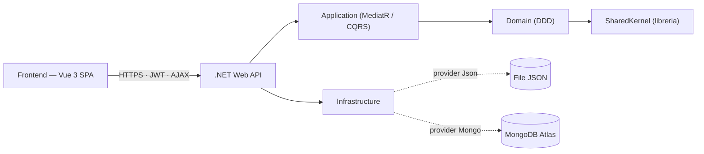

---

## 2. Struttura della soluzione

```
backend/
  src/
    Dhexby.SharedKernel                 → libreria di base (Entity, ValueObject, Result, Error, ...)
    Dhexby.LogisticsEngine.Domain       → aggregati, value object, domain service, regole di business
    Dhexby.LogisticsEngine.Application  → use case (MediatR), validazione, DTO, astrazioni
    Dhexby.LogisticsEngine.Infrastructure → persistenza (JSON/Mongo), auth (hash, JWT)
    Dhexby.LogisticsEngine.Api          → controller HTTP, autenticazione/autorizzazione, Swagger
  tests/
    Dhexby.LogisticsEngine.UnitTests         → dominio + application
    Dhexby.LogisticsEngine.ArchitectureTests → regole architetturali e naming
frontend/                                → SPA Vue 3 (landing, area gestionale, visualizzazioni)
docs/                                    → questa documentazione + pipeline CI
```

### Regola di dipendenza (Clean Architecture)

Le dipendenze puntano **solo verso l'interno**: il Domain non conosce nessuno; l'esterno
dipende dall'interno. Questa regola è **verificata automaticamente** dagli Architecture Test.

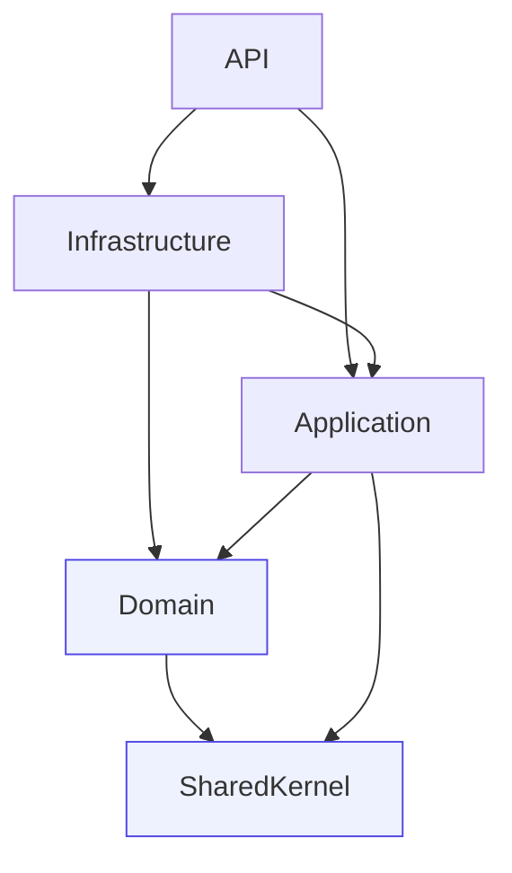

Regole applicate (in `Dhexby.LogisticsEngine.ArchitectureTests`):

- Domain non dipende da Application / Infrastructure / Api
- Application non dipende da Infrastructure / Api
- Infrastructure non dipende da Api
- I controller dipendono dall'Application (MediatR), mai dai repository
- I repository concreti vivono solo in Infrastructure
- Naming: `*Command`, `*Query`, `*Handler`, `*Controller`

---

## 3. La libreria di base — `Dhexby.SharedKernel`

Contiene i mattoni tattici del DDD, riusabili da qualunque aggregato. In particolare il
**Result pattern**: gli errori attesi (regole di business violate, validazione) non usano
eccezioni ma vengono trasportati come `Result` / `Result<T>`.

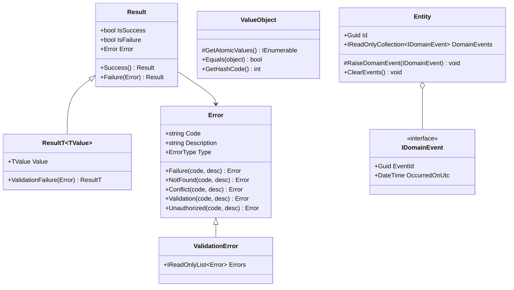

| Blocco | Ruolo |
|---|---|
| `Entity` | Identità (`Id`) + raccolta di eventi di dominio |
| `ValueObject` | Uguaglianza strutturale basata sui valori atomici |
| `Result` / `Result<T>` | Esito esplicito di operazioni (successo/errore) senza eccezioni |
| `Error` / `ErrorType` | Errore tipizzato (Failure, Validation, NotFound, Conflict, Unauthorized, ...) |
| `ValidationError` | Errore composito che aggrega più violazioni |
| `IDomainEvent` / `DomainEvent` | Eventi sollevati dagli aggregati |

---

## 4. Modello di dominio

Ogni funzionalità è uno **slice verticale** attorno a un aggregato. I Value Object incapsulano
le invarianti; gli aggregati espongono metodi di transizione che ritornano `Result`.

### 4.1 Spedizioni (Shipment)

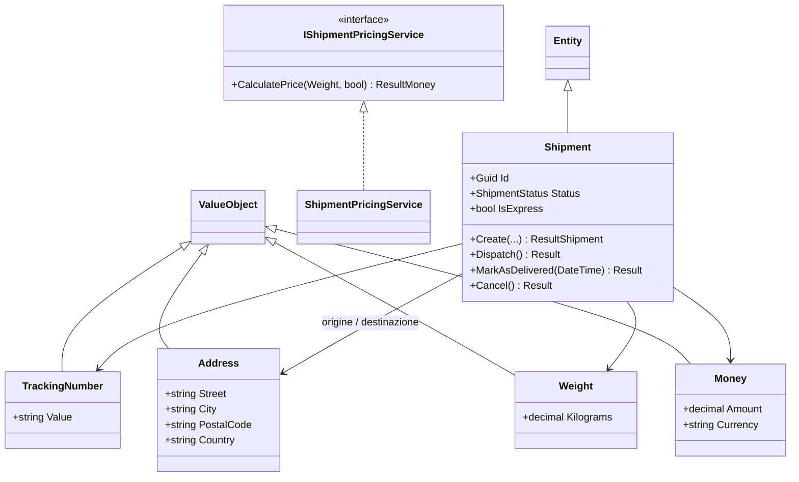

Stati: `Pending → InTransit → Delivered`; `Cancelled` solo da `Pending`.

### 4.2 Ordini (Order) — pronto per Queue / Priority Queue / Stack

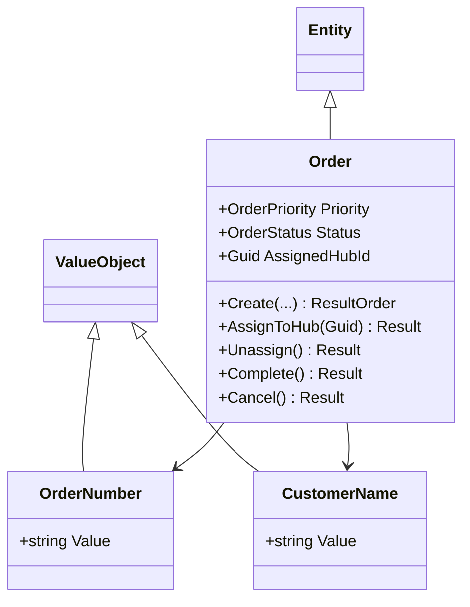

La coppia simmetrica `AssignToHub` / `Unassign` abilita naturalmente **undo/redo** (Stack).
`Priority` (Standard &lt; Express &lt; Priority) alimenta la **coda a priorità**.

### 4.3 Hub e Zone

- **Hub**: nodo della rete logistica. VO `HubCode`, `GeoCoordinate` (con distanza Haversine, euristica per A*).
- **Zone**: albero delle consegne. `Zone` referenzia il padre via `ParentZoneId` e contiene `Street` (foglie).

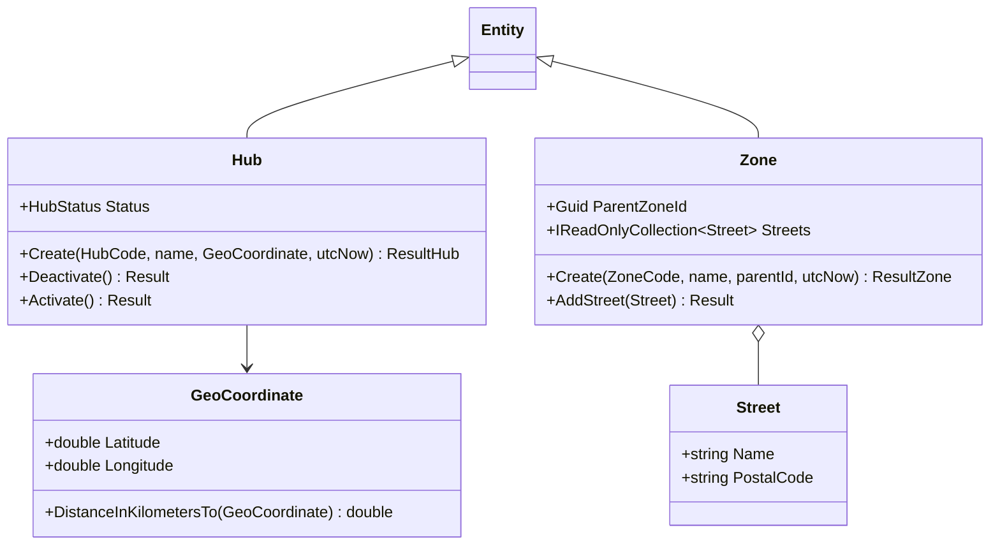

### 4.4 Utenti e autorizzazione (User)

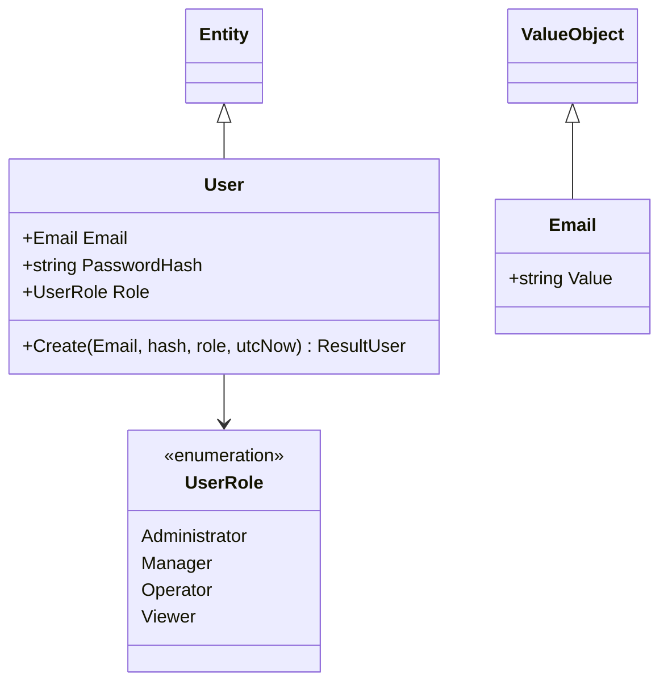

---

## 5. Application layer — CQRS con MediatR

Ogni operazione è un **Command** (scrittura) o una **Query** (lettura) gestito da un
`*Handler`. Una **pipeline behavior** applica la validazione FluentValidation prima
dell'handler; se fallisce ritorna un `Result` fallito (nessuna eccezione).

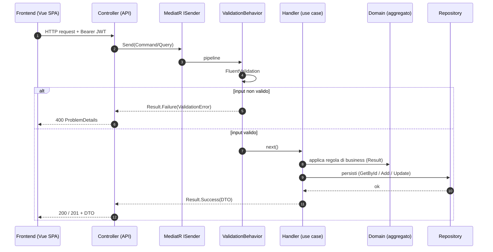

Astrazioni chiave dell'Application layer:

- `IShipmentPricingService`, `IOrderProcessingQueue`, `IOrderDispatchPriorityQueue`, `IDispatchHistory` (domain service)
- `IRouteCalculationService`, `INetworkAnalysisService` (routing/analisi)
- `IPasswordHasher`, `IJwtTokenGenerator` (autenticazione)
- `IRoadNetworkFactory` (assembla il grafo da hub + strade)

I DTO di risposta sono **stabili** e pensati per il frontend, in particolare le "sequenze":
`OrderQueueResponse`, `RouteResponse`, `ReachabilityResponse`, `ZoneTreeResponse`.

---

## 6. Servizi e algoritmi

Le strutture dati e gli algoritmi sono **domain service** nel layer Domain, esposti via
interfaccia e registrati in DI.

### 6.1 Stack — Undo/Redo del dispatch (`DispatchHistoryStack`)

Due pile (`undo`, `redo`) di `DispatchAction`. Registrare un'assegnazione svuota la pila di
redo; `CommitUndo`/`CommitRedo` spostano l'azione in cima da una pila all'altra.
Operazioni **O(1)**. Gli handler applicano/annullano anche la modifica sull'aggregato `Order`.

### 6.2 Queue — Processamento ordini FIFO (`OrderProcessingQueue`)

Costruisce una `Queue<Order>` ordinata per istante di arrivo (`PlacedOnUtc`) e la svuota:
gli ordini si lavorano in ordine di arrivo. Complessità **O(n log n)** per l'ordinamento.

### 6.3 Priority Queue — Express delivery (`OrderDispatchPriorityQueue`)

Usa `PriorityQueue<Order,(int,long)>` con priorità composita: prima la priorità più alta,
a parità il più vecchio (FIFO). Estrazione **O(log n)** per elemento.

### 6.4 Grafo — Rete stradale (`RoadNetwork`, domain service)

Nodi = hub (con `GeoCoordinate`), archi = strade (bidirezionali, con distanza e fattore di
traffico). Costruito da `RoadNetwork.Build(hubs, roads)`.

### 6.5 Cammini minimi e analisi di rete

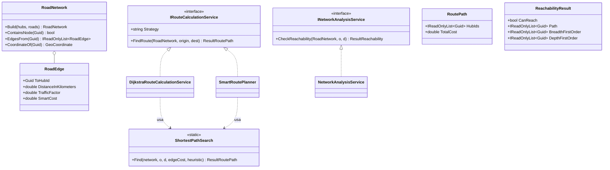

- **Dijkstra** (`DijkstraRouteCalculationService`): cammino minimo per **distanza** fisica (euristica nulla → ricerca a costo uniforme).
- **A\*** (`SmartRoutePlanner`): costo degli archi pesato dal **traffico** (`distanza × fattore`), euristica = distanza geodetica verso la destinazione (ammissibile ⇒ ottimo).
- Entrambi condividono un unico `ShortestPathSearch` parametrizzato per costo ed euristica (DRY). Complessità **O((V+E) log V)** con `PriorityQueue`.
- **BFS/DFS** (`NetworkAnalysisService`): raggiungibilità "posso arrivare a questo hub?" con percorso a minor numero di salti (BFS) e ordini di visita BFS/DFS. Complessità **O(V+E)**.

### 6.6 Tree — Albero delle zone

Ricostruito scendendo ricorsivamente dalle sottozone (`IZoneRepository.GetChildrenAsync`),
con guardia anti-ciclo. Restituito come `ZoneTreeResponse` annidato. Complessità **O(n)**.

---

## 7. Infrastructure — persistenza intercambiabile e sicurezza

I repository concreti implementano le porte del Domain. Il **provider di persistenza** è
scelto da configurazione (`Persistence:Provider` = `Json` | `Mongo`): grazie alla DI si
sostituisce lo storage senza toccare gli altri layer.

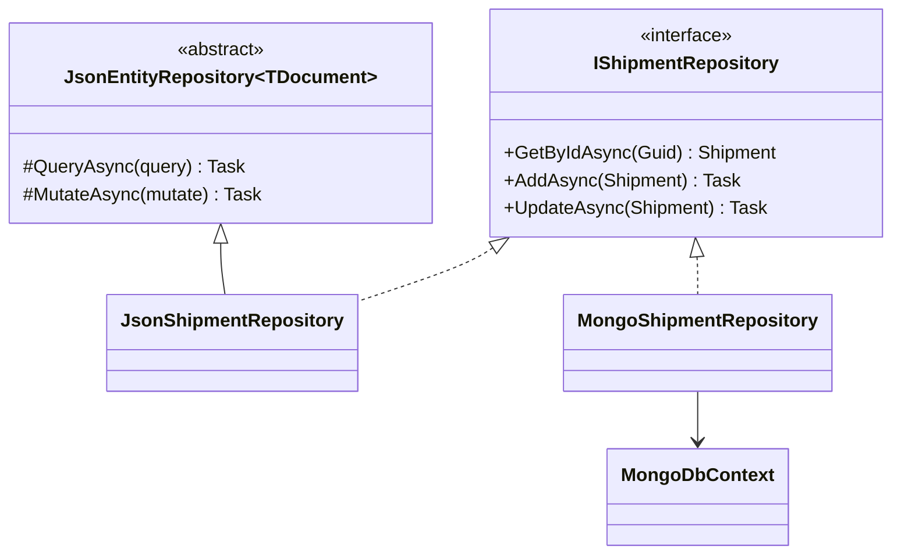

- **JSON**: base condivisa `JsonEntityRepository<TDocument>` (lock + read/mutate su file); un file per aggregato.
- **MongoDB**: `MongoDbContext` (database `LogisticsEngine`, una collection per aggregato); connection string via user-secrets/appsettings non committato.
- **Autenticazione**: `Pbkdf2PasswordHasher` (hash sicuro con salt), `JwtTokenGenerator` (JWT HMAC-SHA256 con claim id/email/ruolo).

---

## 8. API e autorizzazione

Controller sottili raggruppati per entità (`Controllers/Shipments`, `.../Orders`, ...), che
delegano a MediatR. Il `Result` viene tradotto in HTTP: `Validation/Failure → 400`,
`NotFound → 404`, `Conflict → 409`, `Unauthorized → 401`, con corpo **ProblemDetails**.

**Matrice dei ruoli** (applicata con `[Authorize(Roles = ...)]`):

| Ruolo | Lettura (GET) | Azioni operative | Creazione dati | Gestione utenti |
|---|:---:|:---:|:---:|:---:|
| Administrator | ✓ | ✓ | ✓ | ✓ |
| Manager | ✓ | ✓ | ✓ | – |
| Operator | ✓ | ✓ | – | – |
| Viewer | ✓ | – | – | – |

Autenticazione con **JWT Bearer**; endpoint `/api/auth/register` e `/api/auth/login` pubblici.

---

## 9. Diagramma dei casi d'uso

Attori: **Guest** (non autenticato) e i quattro ruoli. La generalizzazione indica che ogni
ruolo eredita i permessi di quello inferiore (Administrator ⊇ Manager ⊇ Operator ⊇ Viewer).

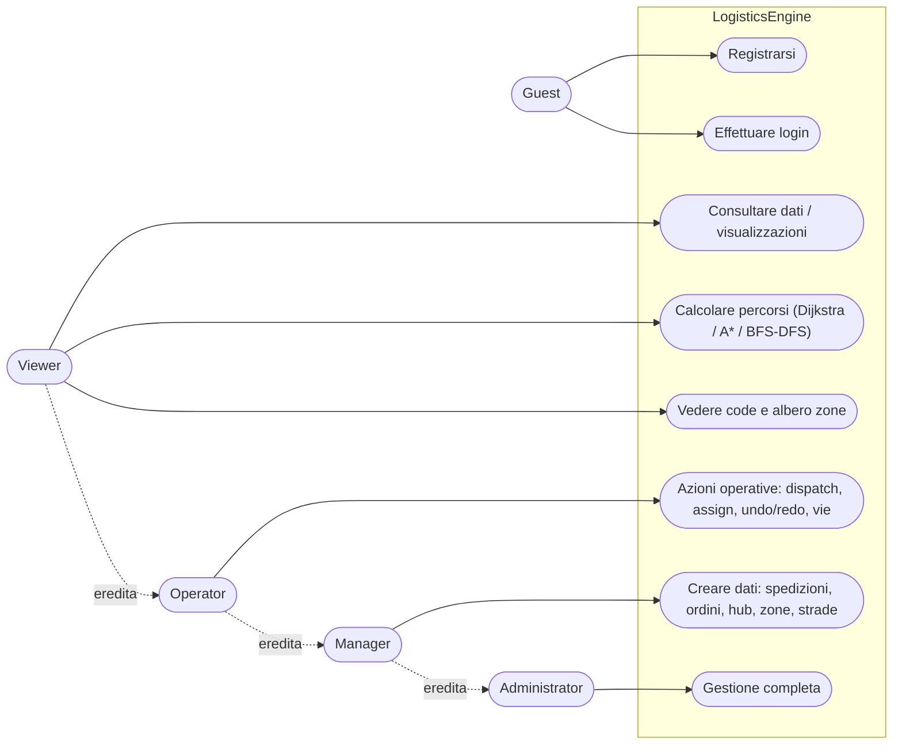

---

## 10. Frontend (SPA Vue 3)

SPA senza build step (Vue + Vue Router via CDN e import map). Landing page, login/registrazione,
area gestionale con sidebar e **visualizzazioni grafiche** (vis-network) di:

- **grafo** della rete con evidenziazione del percorso (Dijkstra/A*/BFS-DFS);
- **albero** delle zone;
- **code** FIFO/priorità e **pile** undo/redo.

I dettagli d'uso sono in [`frontend/README.md`](../frontend/README.md).

---

## 11. Qualità e CI

Pipeline GitHub Actions (`.github/workflows/ci.yml`): restore → build (analyzer Roslyn +
warning-as-error) → format check → unit test + **gate di coverage** → architecture test.
Dettagli in [`docs/ci-pipeline.md`](ci-pipeline.md).

Principi trasversali: **Result pattern** (niente eccezioni per errori attesi), **DRY**
(base repository e ricerca cammini condivise), **SOLID/DIP** (dipendenze verso astrazioni),
validazione centralizzata e regole architetturali verificate dai test.
