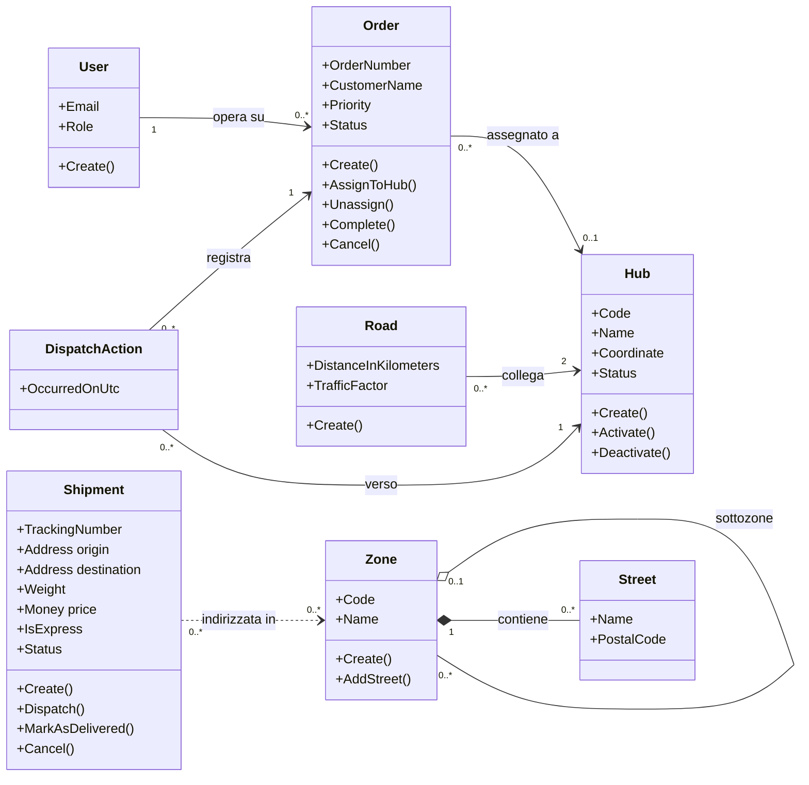
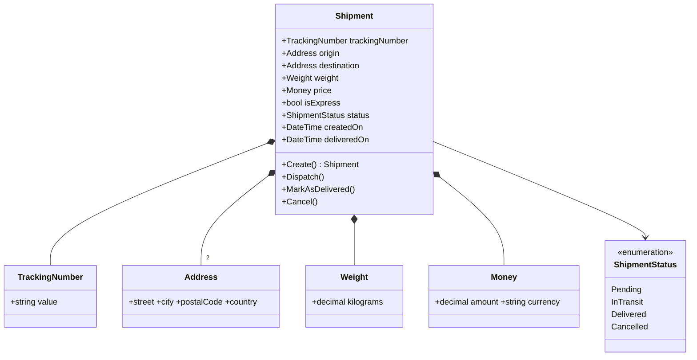
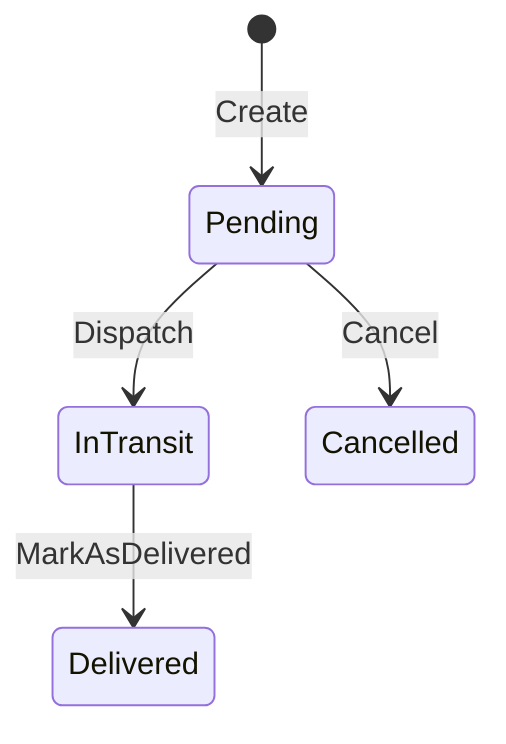
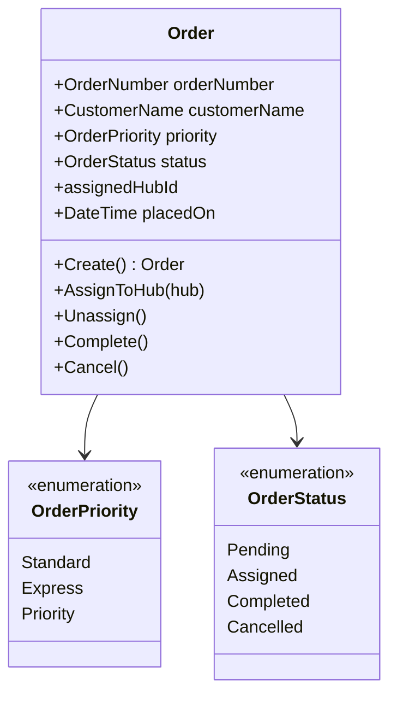
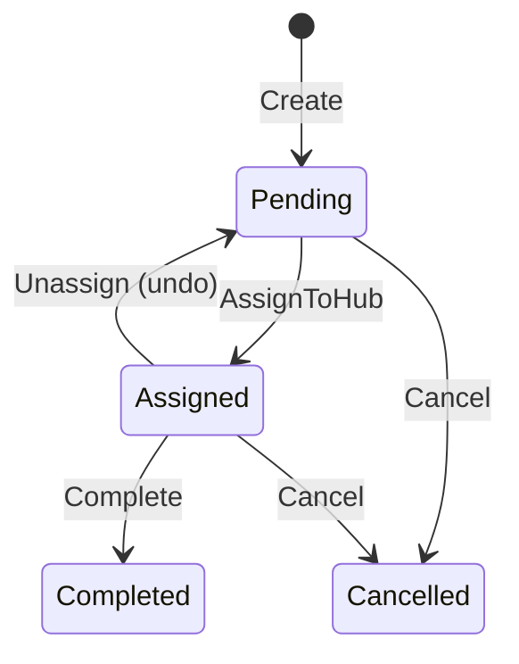
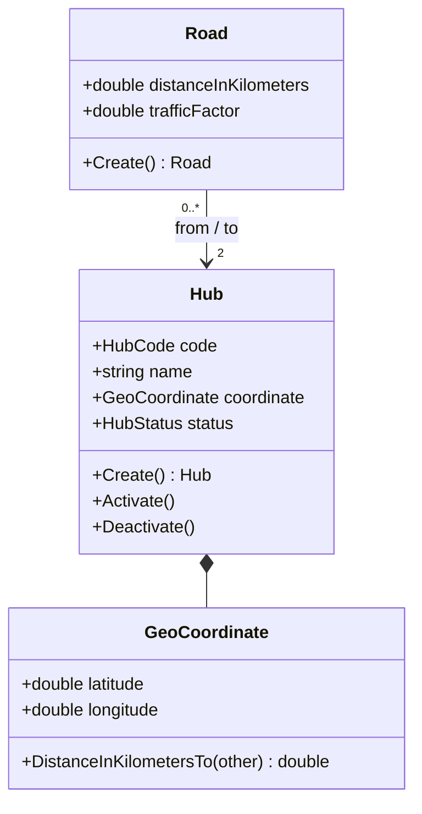
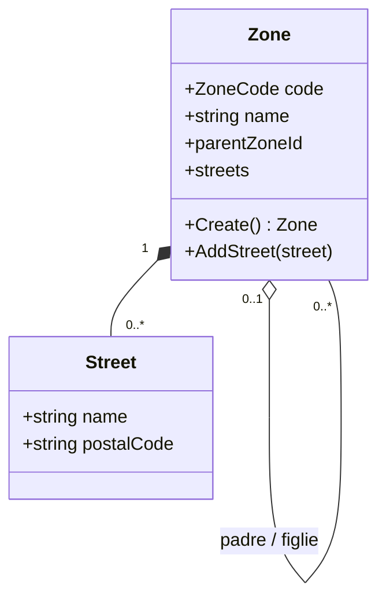
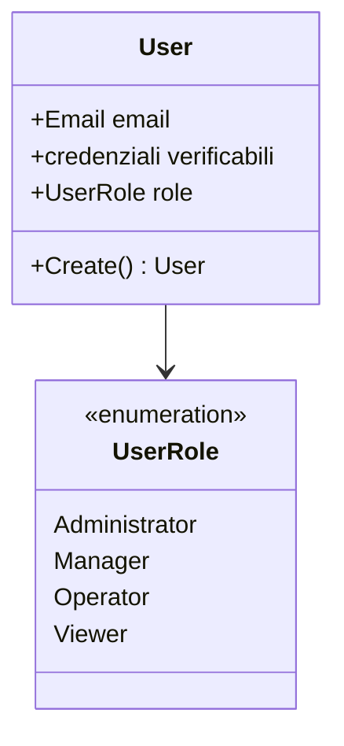

# OO — 1. Conceptual Class Diagram (modello concettuale)

Fase di **analisi orientata agli oggetti (OOA)**: qui si descrive *il dominio*, non il software.
Le classi sono **concetti del mondo logistico** (spedizione, ordine, hub, zona, strada, utente)
con le loro **proprietà** (cosa sanno) e i loro **comportamenti** (cosa sanno fare).

> Nota di metodo: in un modello concettuale puro non si parla di `Guid`, DTO, repository o
> database. Qui i tipi tecnici sono citati solo quando coincidono con un concetto del dominio
> (es. *tracking number*), per mantenere la tracciabilità verso il codice reale
> (→ [OO-4 — physical mapping](OO-4-ood-oop-physical-mapping.md)).

Documenti correlati: [ARCHITECTURE.md](ARCHITECTURE.md) · [OO-2 use cases](OO-2-use-cases.md) ·
[OO-3 OOD relationships](OO-3-ood-relationships.md).

---

## 1. Vocabolario del dominio (ubiquitous language)

| Concetto | Significato nel dominio | Tipo DDD |
|---|---|---|
| **Shipment** (Spedizione) | Un collo che viaggia da un indirizzo di origine a uno di destinazione, con un prezzo e uno stato di consegna | Aggregate root |
| **Order** (Ordine) | La richiesta di un cliente, che viene presa in carico e assegnata a un hub | Aggregate root |
| **Hub** | Nodo fisico della rete logistica (magazzino/centro di smistamento) | Aggregate root |
| **Road** (Strada) | Collegamento percorribile tra due hub, con distanza e traffico | Aggregate root |
| **Zone** (Zona) | Area di consegna, organizzata gerarchicamente in sottozone, contenente vie | Aggregate root |
| **Street** (Via) | Foglia della gerarchia delle zone: nome + CAP | Value Object |
| **User** (Utente) | Chi accede al sistema, con un ruolo che ne determina i permessi | Aggregate root |
| **DispatchAction** | Registrazione storica di un'assegnazione ordine → hub (per undo/redo) | Value Object / record |
| **RoutePath** | Sequenza di hub attraversati e costo totale del percorso | Value Object / record |

**Filosofia degli aggregati.** Ogni concetto in tabella marcato *aggregate root* è un
**confine di consistenza**: dentro il confine le invarianti sono garantite in ogni istante e
si modifica tutto insieme; fuori dal confine ci si riferisce agli altri aggregati **solo per
identità**, mai per puntatore diretto. È per questo che `Order` conosce `AssignedHubId`
(un identificativo) e non un oggetto `Hub`: l'ordine non deve poter modificare l'hub.

---

## 2. Diagramma concettuale d'insieme

Le relazioni sono commentate una per una nel §4.

---

## 3. Concetti in dettaglio: proprietà e comportamenti

### 3.1 Shipment — la spedizione

**Invarianti concettuali**

- origine e destinazione devono essere **diverse**;
- il peso è compreso in `(0, 1000] kg`;
- un importo non è mai negativo e ha sempre una valuta ISO a 3 lettere;
- il tracking number ha formato `TRK-XXXXXXXX`;
- il prezzo **non è un dato in ingresso**: è *calcolato* dalla regola di pricing
  (base + tariffa al kg, +50 % se express).

**Ciclo di vita** — è il cuore del comportamento: i metodi non sono setter, sono
**transizioni di stato che possono rifiutare la richiesta**.

### 3.2 Order — l'ordine

`AssignToHub` e `Unassign` sono **operazioni simmetriche e inverse**: è questa simmetria,
scelta in fase di analisi, che rende possibile l'undo/redo del dispatch senza inventare
concetti nuovi. La `Priority` è un'enumerazione **ordinata** (valore crescente = più urgente)
perché il dominio prevede l'espletamento per urgenza (coda a priorità).

### 3.3 Hub, Road — la rete

- `GeoCoordinate` non è un contenitore passivo: **sa calcolare la distanza** in linea d'aria
  (formula di Haversine). Il comportamento sta dove stanno i dati (*Information Expert*).
- `Road` è **bidirezionale** a livello concettuale: una strada tra A e B è percorribile in
  entrambi i sensi; il `trafficFactor ∈ [1, 10]` esprime quanto il traffico penalizza il
  tratto rispetto alla sua lunghezza pura.
- Hub + Road formano un **grafo pesato**: gli hub sono i vertici, le strade gli archi.

### 3.4 Zone e Street — la gerarchia territoriale

Una zona può avere **una** zona padre (o nessuna, ed è una radice) e **molte** sottozone:
è un **albero**. Le `Street` sono le foglie: una via non esiste al di fuori della sua zona,
e non può comparire due volte nella stessa zona (l'uguaglianza è per *valore*: stesso nome +
stesso CAP = stessa via).

### 3.5 User — l'accesso

Il concetto di **ruolo** è di dominio (chi è autorizzato a fare cosa), mentre la password è
un dettaglio di sicurezza: il dominio conosce solo il fatto che le credenziali sono
*verificabili*, non come sono conservate.

---

## 4. Filosofia delle relazioni

Il tipo di relazione non è un dettaglio grafico: **codifica una regola di vita** degli oggetti.

| Relazione | Notazione | Domanda a cui risponde | Dove nel progetto |
|---|---|---|---|
| **Composizione** | `*--` (rombo pieno) | "Se muore il tutto, muore anche la parte?" **Sì** | `Shipment *-- Address/Weight/Money`, `Zone *-- Street`, `Hub *-- GeoCoordinate` |
| **Aggregazione** | `o--` (rombo vuoto) | La parte esiste anche da sola, ma il tutto la raggruppa | `Zone o-- Zone` (una sottozona sopravvive alla riorganizzazione del padre) |
| **Associazione** | `-->` | Un concetto **conosce** l'altro e ci si riferisce | `Order --> Hub`, `Road --> Hub` |
| **Dipendenza** | `..>` | Uso occasionale/transitorio, non un legame strutturale | `Shipment ..> Zone` (l'indirizzo *ricade* in una zona, non la possiede) |
| **Generalizzazione** | `<|--` | "È un tipo di…" | a livello concettuale quasi assente; compare in fase di design (→ OO-3) |

### 4.1 Composizione: i Value Object

Indirizzo, peso, prezzo, tracking number, coordinata, via **non hanno vita propria**: non
esistono "un peso" o "un indirizzo" indipendenti dalla spedizione o dalla zona che li
possiede. Sono quindi in composizione, e concettualmente sono **Value Object**: contano per
il *valore*, non per l'identità; due indirizzi con gli stessi campi sono **lo stesso**
indirizzo. Questa scelta ha tre conseguenze pratiche:

1. sono **immutabili** — si sostituiscono, non si modificano;
2. sono il posto naturale dove mettere le **regole di validazione** (peso ≤ 1000 kg, valuta
   a 3 lettere, formato del tracking number): l'oggetto non può nemmeno *esistere* invalido;
3. eliminano la *primitive obsession*: un `Weight` non può essere confuso con un `Money`,
   anche se sotto sono entrambi numeri decimali.

### 4.2 Associazione per identità: il confine dell'aggregato

`Order --> Hub` è disegnata come associazione **unidirezionale e per identità**. Il senso è:
l'ordine deve sapere *dove* è stato smistato, ma non deve poter cambiare lo stato dell'hub.
La navigazione inversa (dato un hub, i suoi ordini) non è nel modello perché non serve a
nessuna regola di business: **si modellano solo le relazioni che servono**, altrimenti il
grafo di oggetti diventa un unico blob impossibile da tenere consistente.

Vale lo stesso per `Road --> Hub`: la strada cita due hub, ma non li possiede. Se un hub
viene disattivato, le strade restano; sarà il servizio che costruisce il grafo a decidere
cosa farne.

### 4.3 Molteplicità come regola di business

Le cardinalità non sono decorazione:

- `Order "0..*" --> "0..1" Hub` — un ordine può **non essere ancora assegnato**: è
  esattamente la differenza tra lo stato `Pending` e `Assigned`;
- `Road --> "2" Hub` — una strada senza due estremi distinti non ha senso (regola
  "from ≠ to");
- `Zone "0..1" o-- "0..*" Zone` — un solo padre: è ciò che rende la struttura un **albero**
  e non un grafo generico, e quindi ciò che garantisce che la visita gerarchica termini;
- `Shipment *-- "2" Address` — due indirizzi, che la regola di dominio impone **diversi**.

### 4.4 Relazioni "derivate": le strutture algoritmiche

Alcune relazioni del sistema non sono strutturali ma **calcolate al volo** a partire dai
concetti di base, e per questo nel diagramma concettuale non compaiono come attributi:

| Struttura | Come nasce | Serve a |
|---|---|---|
| **Grafo della rete** | insieme di `Hub` + insieme di `Road` | cammini minimi, raggiungibilità |
| **Coda FIFO** | tutti gli `Order` in stato `Pending` ordinati per data | ordine di lavorazione |
| **Coda a priorità** | gli stessi ordini, ordinati per `Priority` poi per data | express delivery |
| **Pila undo/redo** | sequenza di `DispatchAction` | annullare/ripetere assegnazioni |
| **Albero delle zone** | `Zone` collegate tramite il padre | copertura territoriale |

La filosofia è: **il dominio dichiara i fatti, i servizi ne derivano le strutture**. Un ordine
non "sa" di stare in una coda; è la coda a sapere come ordinare gli ordini. Così le strutture
dati possono cambiare (heap, coda concorrente, cache) senza toccare il modello concettuale.

---

## 5. Perché il comportamento sta nel modello (e non altrove)

Il diagramma elenca per ogni concetto sia proprietà sia **operazioni**, e questo non è casuale:

- **niente setter pubblici**: lo stato cambia solo attraverso operazioni che hanno un nome del
  dominio (`Dispatch`, `Unassign`, `AddStreet`) e che possono **rifiutare** l'operazione;
- **creazione controllata**: ogni concetto nasce da una `Create` che verifica le invarianti —
  non esiste una spedizione "a metà";
- **esito esplicito, non eccezioni**: la violazione di una regola di business è un risultato
  *previsto* (`Result`), non un guasto;
- **eventi**: ogni transizione riuscita annuncia un fatto avvenuto (`ShipmentDispatched`,
  `OrderAssigned`, `ZoneCreated`), che è il vocabolario con cui il dominio si racconta.

Questo è ciò che distingue un modello a oggetti da un *anemic domain model*, cioè da un
insieme di strutture dati con la logica dispersa nei servizi.
