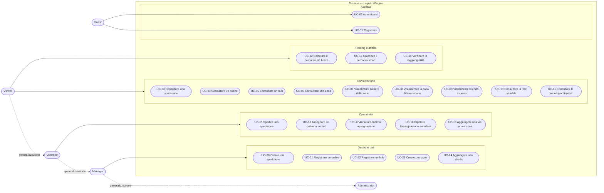
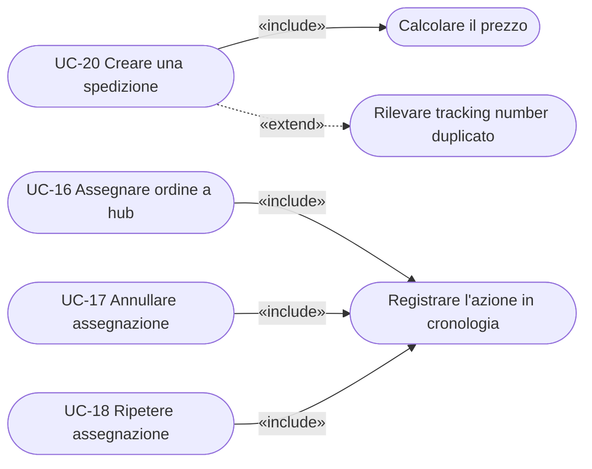
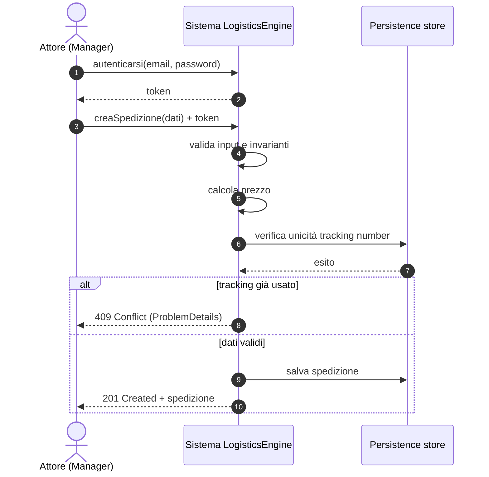

# OO — 2. Use Cases e Use Case Diagram

Fase di analisi dei **requisiti funzionali**: chi usa il sistema (attori), che cosa vuole
ottenerne (casi d'uso) e con quale flusso. Il criterio adottato è quello classico: un caso
d'uso è **un obiettivo osservabile di un attore**, non una schermata né un endpoint.

Documenti correlati: [OO-1 modello concettuale](OO-1-conceptual-class-diagram.md) ·
[OO-3 OOD relationships](OO-3-ood-relationships.md) ·
[OO-4 physical mapping](OO-4-ood-oop-physical-mapping.md).

---

## 1. Attori

| Attore | Tipo | Descrizione |
|---|---|---|
| **Guest** | primario | Utente non autenticato: può solo registrarsi o autenticarsi |
| **Viewer** | primario | Sola lettura: consulta dati, code, albero delle zone, percorsi |
| **Operator** | primario | Viewer + azioni operative su dati esistenti (dispatch, assegnazione, undo/redo, vie) |
| **Manager** | primario | Operator + creazione dei dati anagrafici (spedizioni, ordini, hub, zone, strade) |
| **Administrator** | primario | Massimo privilegio: tutto ciò che può fare il Manager |
| **Persistence store** | secondario | Sistema esterno di supporto (file JSON o MongoDB Atlas) |

**Filosofia della generalizzazione fra attori.** I ruoli sono in *generalizzazione*
(`Administrator → Manager → Operator → Viewer`): un attore più specifico eredita tutti i casi
d'uso di quello più generale. Questo evita di ridisegnare le stesse frecce quattro volte ed è
esattamente ciò che il codice implementa con i gruppi di ruoli (`ManageData`, `Operate`).

---

## 2. Use Case Diagram

> Le frecce tratteggiate vanno lette come "…è generalizzato da…": l'`Operator` **è anche** un
> `Viewer`, quindi ne eredita i casi d'uso; l'`Administrator` li eredita tutti.

### Relazioni `<<include>>` e `<<extend>>`

- **`<<include>>`** = comportamento **obbligatorio e riusato**. Il calcolo del prezzo è sempre
  eseguito quando si crea una spedizione: il cliente non lo fornisce mai. La registrazione in
  cronologia è condivisa dai tre casi d'uso di dispatching.
- **`<<extend>>`** = comportamento **eventuale**, attivato da una condizione. Il conflitto sul
  tracking number si verifica solo se il numero esiste già.

Il criterio: `include` toglie duplicazione fra casi d'uso, `extend` isola le varianti senza
sporcare il flusso principale.

---

## 3. Catalogo dei casi d'uso

`R` = lettura (query), `W` = scrittura (command). "Ruolo minimo" indica il ruolo meno
privilegiato che può eseguire il caso d'uso (i ruoli superiori lo ereditano).

| ID | Caso d'uso | Tipo | Ruolo minimo | Endpoint | Use case (Application) |
|---|---|:--:|---|---|---|
| UC-01 | Registrarsi | W | Guest | `POST /api/auth/register` | `RegisterUserCommand` |
| UC-02 | Autenticarsi | W | Guest | `POST /api/auth/login` | `LoginCommand` |
| UC-03 | Consultare una spedizione | R | Viewer | `GET /api/shipments/{id}` | `GetShipmentByIdQuery` |
| UC-04 | Consultare un ordine | R | Viewer | `GET /api/orders/{id}` | `GetOrderByIdQuery` |
| UC-05 | Consultare un hub | R | Viewer | `GET /api/hubs/{id}` | `GetHubByIdQuery` |
| UC-06 | Consultare una zona | R | Viewer | `GET /api/zones/{id}` | `GetZoneByIdQuery` |
| UC-07 | Visualizzare l'albero delle zone | R | Viewer | `GET /api/zones/{id}/tree` | `GetZoneTreeQuery` |
| UC-08 | Visualizzare la coda di lavorazione | R | Viewer | `GET /api/orders/processing-queue` | `GetOrderProcessingQueueQuery` |
| UC-09 | Visualizzare la coda express | R | Viewer | `GET /api/orders/express-queue` | `GetExpressDispatchQueueQuery` |
| UC-10 | Consultare la rete stradale | R | Viewer | `GET /api/roads/network` | `GetRoadNetworkQuery` |
| UC-11 | Consultare la cronologia dispatch | R | Viewer | `GET /api/dispatch/history` | `GetDispatchHistoryQuery` |
| UC-12 | Calcolare il percorso più breve | R | Viewer | `GET /api/routes/shortest` | `GetShortestRouteQuery` (Dijkstra) |
| UC-13 | Calcolare il percorso smart | R | Viewer | `GET /api/routes/smart` | `GetSmartRouteQuery` (A\*) |
| UC-14 | Verificare la raggiungibilità | R | Viewer | `GET /api/routes/reachability` | `GetHubReachabilityQuery` (BFS/DFS) |
| UC-15 | Spedire una spedizione | W | Operator | `POST /api/shipments/{id}/dispatch` | `DispatchShipmentCommand` |
| UC-16 | Assegnare un ordine a un hub | W | Operator | `POST /api/orders/{id}/assign` | `AssignOrderCommand` |
| UC-17 | Annullare l'ultima assegnazione | W | Operator | `POST /api/dispatch/undo` | `UndoDispatchCommand` |
| UC-18 | Ripetere l'assegnazione annullata | W | Operator | `POST /api/dispatch/redo` | `RedoDispatchCommand` |
| UC-19 | Aggiungere una via a una zona | W | Operator | `POST /api/zones/{id}/streets` | `AddStreetToZoneCommand` |
| UC-20 | Creare una spedizione | W | Manager | `POST /api/shipments` | `CreateShipmentCommand` |
| UC-21 | Registrare un ordine | W | Manager | `POST /api/orders` | `PlaceOrderCommand` |
| UC-22 | Registrare un hub | W | Manager | `POST /api/hubs` | `RegisterHubCommand` |
| UC-23 | Creare una zona | W | Manager | `POST /api/zones` | `CreateZoneCommand` |
| UC-24 | Aggiungere una strada | W | Manager | `POST /api/roads` | `AddRoadCommand` |

**Comportamenti di dominio non ancora esposti come casi d'uso**: `Shipment.MarkAsDelivered`,
`Shipment.Cancel`, `Order.Complete`, `Order.Cancel`, `Hub.Activate/Deactivate` esistono e sono
testati nel dominio, ma non hanno (ancora) un endpoint. È una scelta consapevole: il modello
può essere più ricco della superficie applicativa esposta, mai il contrario.

**Nota sulla registrazione**: `POST /api/auth/register` è pubblico e accetta il ruolo
richiesto; è una semplificazione didattica. In un sistema reale la creazione di utenti con
ruoli privilegiati sarebbe un caso d'uso riservato all'`Administrator`.

---

## 4. Casi d'uso espansi (formato "fully dressed")

### UC-20 — Creare una spedizione

| | |
|---|---|
| **Attore primario** | Manager (o Administrator) |
| **Portata** | Sistema LogisticsEngine |
| **Precondizioni** | L'attore è autenticato con token valido e ruolo `Manager`/`Administrator` |
| **Garanzia di successo** | Esiste una nuova spedizione in stato `Pending`, con prezzo calcolato e tracking number univoco; è stato pubblicato l'evento `ShipmentCreated` |
| **Trigger** | L'attore invia i dati della spedizione |

**Scenario principale**

1. L'attore fornisce tracking number, indirizzo di origine, indirizzo di destinazione, peso e flag express.
2. Il sistema **valida il formato** dell'input (campi obbligatori, peso positivo).
3. Il sistema costruisce i Value Object `TrackingNumber`, `Address` (×2), `Weight`; ogni costruzione applica le proprie invarianti.
4. Il sistema verifica che il tracking number non sia già in uso.
5. Il sistema **calcola il prezzo** (`<<include>>`: base + tariffa al kg, ×1,5 se express).
6. Il sistema crea la spedizione: verifica che origine ≠ destinazione, la porta in stato `Pending` e registra l'evento di dominio.
7. Il sistema persiste la spedizione e restituisce la rappresentazione creata.

**Estensioni (flussi alternativi)**

- **2a. Input malformato** → il sistema risponde `400` con l'elenco degli errori di validazione; nulla viene creato.
- **3a. Invariante di Value Object violata** (peso > 1000 kg, valuta non valida, tracking non conforme) → `400` con il codice d'errore di dominio.
- **4a. Tracking number già esistente** (`<<extend>>`) → `409 Conflict`.
- **6a. Origine uguale a destinazione** → `400` con `Shipment.SameOriginAndDestination`.

**Requisiti non funzionali**: nessuna eccezione usata per gli errori attesi (Result pattern);
risposta d'errore sempre in formato `ProblemDetails`.

---

### UC-16 / UC-17 / UC-18 — Assegnare, annullare, ripetere il dispatch

Sono tre casi d'uso distinti ma **accoppiati dalla stessa cronologia**: è il gruppo che rende
osservabile la struttura dati a pila.

| | |
|---|---|
| **Attore primario** | Operator (o superiore) |
| **Precondizioni** | Attore autenticato; per UC-17 la pila di undo non è vuota; per UC-18 la pila di redo non è vuota |
| **Garanzia di successo** | Lo stato dell'ordine e la cronologia sono coerenti fra loro |

**Scenario principale di UC-16 (assegnazione)**

1. L'attore indica ordine e hub di destinazione.
2. Il sistema carica l'ordine; se non esiste → `404`.
3. Il sistema verifica che l'ordine sia `Pending`; altrimenti → errore di conflitto.
4. L'ordine passa a `Assigned` memorizzando l'identità dell'hub, ed emette `OrderAssigned`.
5. Il sistema **registra l'azione** nella pila di undo (`<<include>>`) e **svuota la pila di redo**.
6. Il sistema persiste l'ordine.

**UC-17 (undo)**: il sistema legge (senza rimuoverla) l'azione in cima alla pila di undo,
riporta l'ordine a `Pending` con `Unassign`, persiste e **solo allora** sposta l'azione dalla
pila di undo a quella di redo. L'ordine delle operazioni non è casuale: se la persistenza
fallisse, la cronologia resterebbe allineata allo stato reale.

**UC-18 (redo)**: simmetrico — riassegna l'ordine allo stesso hub e sposta l'azione da redo a undo.

**Estensioni**

- **UC-17.1 Pila di undo vuota** → errore "nothing to undo".
- **UC-17.2 L'ordine nel frattempo non è più `Assigned`** → l'operazione viene rifiutata dalla regola di dominio.
- **UC-16.5a Nuova assegnazione dopo un undo** → la pila di redo viene azzerata: si perde il "futuro" alternativo, esattamente come in un editor di testo.

**Nota di progettazione**: la cronologia è **in memoria** (singleton per la durata del
processo), quindi undo/redo non sopravvivono a un riavvio. È una scelta didattica dichiarata,
non una svista.

---

### UC-12 / UC-13 / UC-14 — Percorsi e raggiungibilità

| | |
|---|---|
| **Attore primario** | Viewer (o superiore) |
| **Precondizioni** | Attore autenticato; hub di origine e destinazione esistenti nella rete |
| **Garanzia di successo** | L'attore ottiene una sequenza ordinata di hub e il costo totale, oppure un esito motivato di "nessun percorso" |

**Scenario principale**

1. L'attore indica hub di origine e hub di destinazione.
2. Il sistema **assembla il grafo** della rete a partire da tutti gli hub e da tutte le strade (`<<include>>` condiviso dai tre casi d'uso).
3. Il sistema applica la strategia richiesta:
   - UC-12 → costo = distanza in km, euristica nulla (**Dijkstra**);
   - UC-13 → costo = distanza × fattore di traffico, euristica = distanza in linea d'aria verso la destinazione (**A\***);
   - UC-14 → visita in ampiezza (**BFS**, percorso a minor numero di salti) affiancata da una visita in profondità (**DFS**).
4. Il sistema restituisce il percorso, il costo (o il numero di salti) e — per UC-14 — anche gli ordini di visita, che il frontend usa per l'animazione.

**Estensioni**

- **3a. Origine non presente nella rete** → errore `Route.OriginNotInNetwork`.
- **3b. Destinazione non presente** → errore `Route.DestinationNotInNetwork`.
- **3c. Grafo disconnesso fra i due nodi** → UC-12/13 restituiscono `Route.NoRouteFound`; UC-14 risponde correttamente `canReach = false` con percorso vuoto (per UC-14 **non è un errore**: è la risposta alla domanda posta).

**Perché tre casi d'uso e non uno parametrico**: gli obiettivi dell'attore sono diversi —
"qual è la strada più corta", "qual è la strada più veloce col traffico attuale", "ci si
arriva del tutto?". Casi d'uso distinti con contratti stabili; è il *design* (non l'analisi) a
riusare un unico algoritmo di ricerca sottostante (→ [OO-3](OO-3-ood-relationships.md)).

---

## 5. Diagramma di sequenza di sistema (SSD) — tipico caso d'uso di scrittura

Vista "scatola nera": cosa attraversa il confine del sistema.

La realizzazione interna di questo scambio (controller → MediatR → validazione → handler →
aggregato → repository) è documentata in [ARCHITECTURE.md §5](ARCHITECTURE.md) e mappata sui
file in [OO-4](OO-4-ood-oop-physical-mapping.md).
