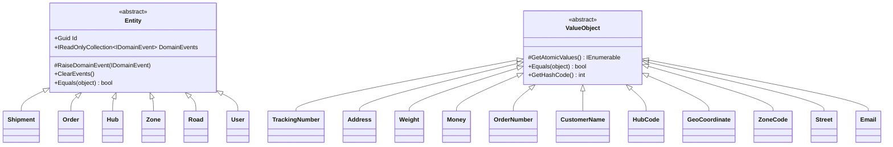
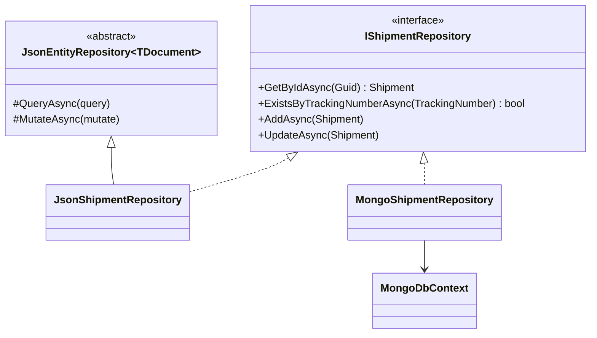
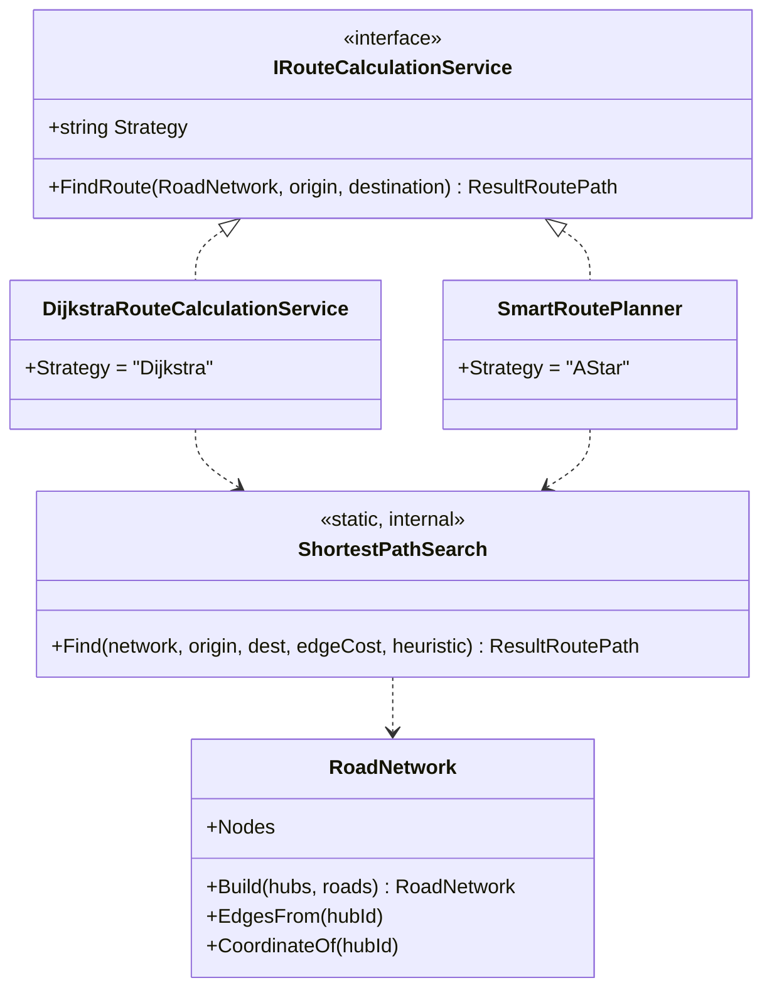
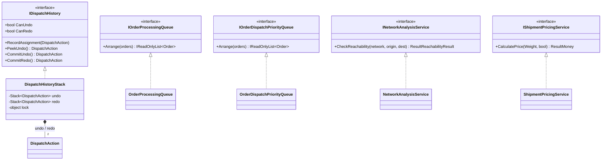
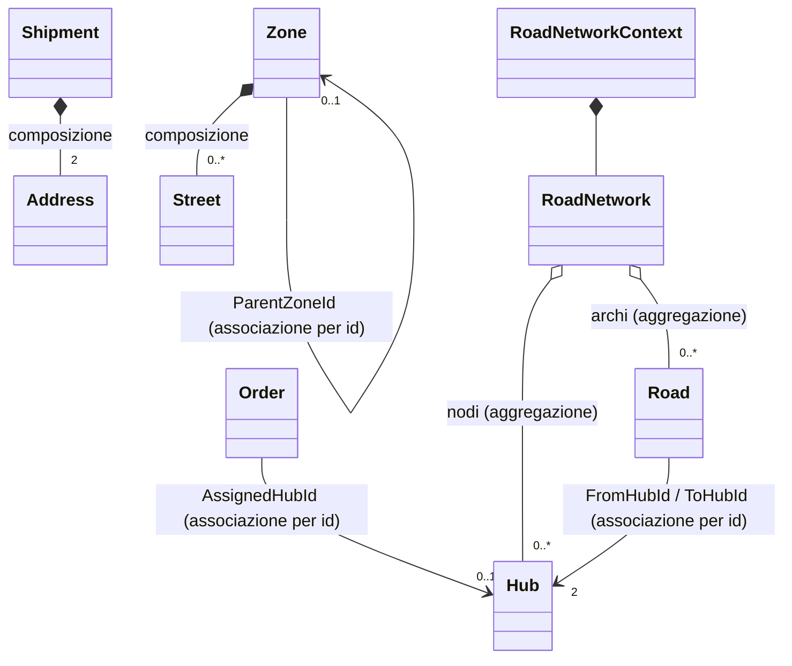
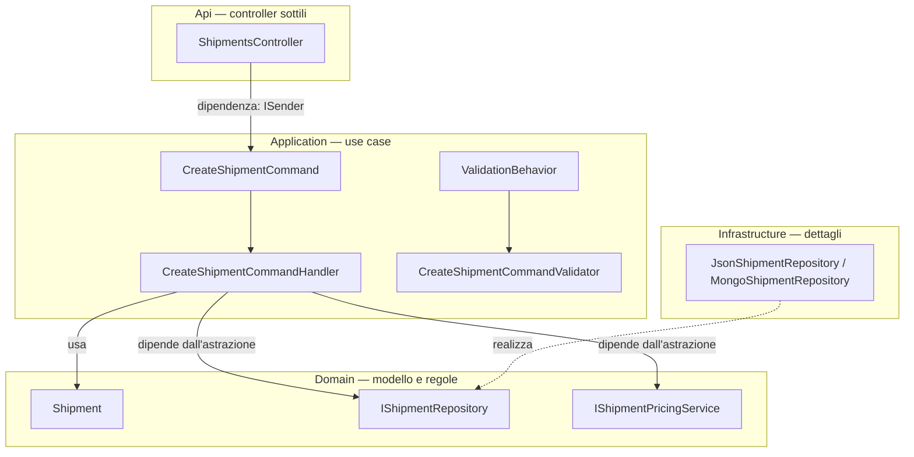

# OO — 3. OOD: relazioni di progettazione

Dal **modello concettuale** ([OO-1](OO-1-conceptual-class-diagram.md)) al **modello di
progetto**. In analisi si descrive il dominio; in **OOD** si decide *come* le classi
collaborano: chi eredita da chi, chi realizza quale contratto, chi dipende da chi e in quale
verso. Le relazioni qui sono scelte tecniche con conseguenze misurabili su accoppiamento,
testabilità e possibilità di sostituire i pezzi.

---

## 1. Il catalogo delle relazioni usate

| Relazione UML | Sintassi Mermaid | Significato in OOD | Realizzazione in C# |
|---|---|---|---|
| Generalizzazione | `A <|-- B` | B **è un** A, riusa lo stato/comportamento di base | `class B : A` |
| Realizzazione | `I <|.. C` | C **rispetta il contratto** I, senza ereditarne codice | `class C : I` (interfaccia) |
| Composizione | `A *-- B` | B è **parte di** A, creato e distrutto con esso | campo `readonly`/proprietà interna, mai esposto per la modifica |
| Aggregazione | `A o-- B` | A raggruppa B, che vive anche fuori | collezione di elementi passati dall'esterno |
| Associazione | `A --> B` | A **conosce** B in modo stabile | campo/proprietà, oppure **id** se si attraversa un aggregato |
| Dipendenza | `A ..> B` | A **usa** B temporaneamente (parametro, valore di ritorno, variabile locale) | firma di metodo |

**Principio guida**: si sceglie sempre la relazione **più debole** che risolve il problema.
Una dipendenza è meglio di un'associazione, un'associazione è meglio di una composizione, la
composizione è meglio dell'ereditarietà. L'ereditarietà è la relazione più forte e più rigida
esistente fra due classi: si paga in flessibilità e la si usa solo dove esprime davvero un
"è un".

---

## 2. Generalizzazione: le sole due gerarchie del progetto

Le due gerarchie non esprimono una tassonomia del dominio ("un ordine è una spedizione
particolare" sarebbe falso): esprimono **due modelli di identità diversi**, ed è l'unica cosa
che le classi base forniscono.

- `Entity` → **identità per riferimento**: due spedizioni con gli stessi dati restano
  spedizioni *diverse*, perché hanno `Id` diverso. La classe base implementa l'uguaglianza per
  `Id` e ospita il meccanismo degli eventi di dominio.
- `ValueObject` → **identità per valore**: `Equals` e `GetHashCode` sono implementati **una
  volta sola** confrontando i valori atomici che la sottoclasse dichiara con
  `GetAtomicValues()`. È un **Template Method**: la base fissa l'algoritmo di confronto, la
  sottoclasse fornisce solo il "cosa confrontare".

Da questa scelta discendono conseguenze pratiche: `Zone.AddStreet` può rifiutare un duplicato
con un semplice `Contains`, e `Shipment.Create` può confrontare origine e destinazione con
`Equals` — comportamento "gratuito", ereditato.

**Perché nessun'altra gerarchia.** Non esistono `ExpressShipment : Shipment` né
`PriorityOrder : Order`: la variabilità è modellata con **dati** (`IsExpress`, `Priority`) e
**strategie** (§3), non con sottoclassi. Sottoclassificare per una proprietà che può cambiare
nel tempo è una delle trappole classiche dell'ereditarietà.

---

## 3. Realizzazione: interfacce come giunti sostituibili

Ogni interfaccia del progetto esiste per una ragione precisa, riconducibile a tre categorie.

### 3.1 Porte verso l'esterno (Repository — DIP)

Il **contratto vive nel Domain, l'implementazione in Infrastructure**: è l'inversione delle
dipendenze (DIP) resa visibile. La freccia di compilazione va da Infrastructure verso Domain,
cioè **contro** il flusso del controllo. Il risultato è che due implementazioni radicalmente
diverse (file JSON e MongoDB Atlas) sono intercambiabili da configurazione.

Qui convivono le due relazioni forti in modo pulito:

- **realizzazione** verso `IShipmentRepository` → *cosa* il resto del sistema può chiedere;
- **generalizzazione** da `JsonEntityRepository<TDocument>` → *come* si legge/scrive un file
  (lock, serializzazione, read-modify-write), condiviso da tutti i repository JSON.
  È di nuovo un **Template Method**: la base incapsula la meccanica, la sottoclasse fornisce
  path e mappatura documento ↔ dominio.

### 3.2 Strategie di dominio (Strategy)

Due strategie dietro **lo stesso contratto**, e sotto **un solo algoritmo**: la ricerca
generalizzata riceve come parametri la funzione di costo dell'arco e l'euristica.

- euristica `≡ 0` + costo = distanza → **Dijkstra** (ricerca a costo uniforme);
- euristica = distanza geodetica + costo = distanza × traffico → **A\***.

Le due relazioni in gioco sono diverse e vale la pena distinguerle: verso l'interfaccia c'è
**realizzazione** (contratto pubblico e sostituibile); verso `ShortestPathSearch` c'è una
**dipendenza** (uso interno, `internal` e `static`, non parte dell'API di dominio). Se domani
si sostituisse l'implementazione con una ricerca bidirezionale, nessun client se ne
accorgerebbe.

Perché non ereditarietà (`SmartRoutePlanner : DijkstraRouteCalculationService`)? Perché A\*
non *è un* Dijkstra dal punto di vista del cliente, e legarli congelerebbe l'uno all'altro.
Composizione di funzioni al posto dell'ereditarietà: accoppiamento minore, riuso identico.

### 3.3 Strutture dati come servizi

Osservazioni di progetto:

- `IOrderProcessingQueue` e `IOrderDispatchPriorityQueue` hanno **la stessa firma** ma sono
  due interfacce separate. È **Interface Segregation** applicata al significato: un handler
  chiede la coda che gli serve, e la DI non può iniettargli quella sbagliata. Fondere le due
  in un `IOrderArranger` renderebbe il codice più corto e il progetto più ambiguo.
- Le code sono **stateless** (ricevono gli ordini e ne restituiscono la disposizione), la
  cronologia è **stateful**. La differenza si traduce direttamente in scelte di *lifetime*
  nella DI e nella necessità di sincronizzazione (`lock`) solo per la seconda.
- `IShipmentPricingService` è un **domain service** perché la regola di pricing non appartiene
  naturalmente né al `Weight` né alla `Shipment`: coinvolge più concetti e cambia per motivi
  commerciali. Isolarla la rende sostituibile e testabile senza costruire una spedizione.

### 3.4 Astrazioni tecniche dell'Application

`IPasswordHasher`, `IJwtTokenGenerator`, `IRoadNetworkFactory`: interfacce dichiarate in
Application e realizzate altrove (Infrastructure le prime due). Servono a impedire che uno use
case dipenda da PBKDF2 o dalla libreria JWT — dettagli che possono cambiare senza che cambi
il caso d'uso.

---

## 4. Composizione, aggregazione, associazione: le scelte concrete

### 4.1 Composizione = incapsulamento reale

`Zone` contiene le sue `Street` in una lista **privata** ed espone solo una vista in sola
lettura; l'unico modo per aggiungere una via è il metodo `AddStreet`, che applica la regola
sui duplicati. Se la lista fosse esposta modificabile, la composizione sarebbe una bugia: la
regola sarebbe aggirabile dall'esterno. **La composizione si difende con l'incapsulamento,
non con il diagramma.**

Stesso schema per i Value Object di `Shipment`: proprietà con setter privato, sostituibili
solo attraverso metodi di transizione.

### 4.2 Associazione per identità = confine dell'aggregato

`Order` non ha un campo `Hub Hub`, ha `Guid? AssignedHubId`. È **la** regola strutturale del
DDD tattico, e ha tre effetti concreti:

1. impedisce a un caso d'uso di modificare due aggregati nella stessa transazione per
   distrazione;
2. mantiene piccolo il grafo caricato in memoria (nessun *lazy loading*, nessuna sorpresa di
   performance);
3. rende la persistenza banale: un documento per aggregato, senza join né riferimenti
   circolari.

Il costo è che le validazioni "incrociate" (l'hub esiste? è attivo?) risalgono agli
*handler*, che possono interrogare più repository. È un costo accettato e visibile, non
nascosto.

### 4.3 Aggregazione = strutture derivate

`RoadNetwork` **non possiede** hub e strade: li riceve già esistenti e ne costruisce una
rappresentazione (liste di adiacenza + coordinate). Se il grafo viene buttato via, hub e
strade continuano a esistere. Da qui due proprietà di progetto:

- il grafo è **immutabile e usa-e-getta**, costruito da un factory per ogni richiesta di
  routing;
- ignora silenziosamente le strade che puntano a hub non presenti — una scelta di robustezza
  che tiene la costruzione totale (non fallisce mai) e sposta la segnalazione degli errori
  sull'algoritmo che, non trovando il nodo, restituisce un errore parlante.

---

## 5. Dipendenze: verso dove puntano le frecce

Tre regole di progetto leggibili in questo diagramma:

1. **Il controller non conosce i repository.** Dipende solo da `ISender` (Mediator): un unico
   punto di ingresso, nessuna logica applicativa nell'API. È una regola verificata
   automaticamente dagli **Architecture Test**, non solo una convenzione scritta.
2. **L'handler dipende da interfacce**, mai da classi concrete di Infrastructure. Nei test si
   sostituiscono con dei doppi senza toccare filesystem o database.
3. **La freccia di realizzazione punta verso l'interno.** È l'unico modo per avere un Domain
   che non dipende da nulla — condizione perché le regole di business siano testabili in
   isolamento e sopravvivano al cambio di ogni tecnologia intorno.

### 5.1 La pipeline di validazione (Decorator / Chain of Responsibility)

`ValidationBehavior<TRequest, TResponse>` si interpone fra il mediator e l'handler: valida
la richiesta e, se fallisce, **non chiama** l'handler e ritorna un `Result` fallito. Non è
ereditarietà, non è un'associazione: è una **decorazione** applicata a *tutti* gli use case.
Aggiungere logging, caching o transazioni significa aggiungere un anello alla catena, non
modificare 24 handler — **Open/Closed** in pratica.

### 5.2 Result invece di eccezioni

`Result` / `Result<T>` attraversa tutte le relazioni del progetto: aggregato → handler →
controller → HTTP. Sul piano OOD è una scelta di *contratto*: l'esito negativo previsto
(regola violata, dato non trovato, conflitto) fa parte del **tipo di ritorno**, quindi è
visibile nella firma e impossibile da ignorare per distrazione. Le eccezioni restano per ciò
che è davvero eccezionale (guasti, bug).

---

## 6. Pattern presenti e ruolo che svolgono

| Pattern | Dove | Problema che risolve |
|---|---|---|
| **Factory Method** | `Shipment.Create`, `Order.Create`, `Road.Create`, `Street.Create`, … | Un solo punto di creazione valido; impossibile ottenere un oggetto invalido |
| **Template Method** | `ValueObject.Equals` + `GetAtomicValues`; `JsonEntityRepository` | L'algoritmo sta nella base, il dettaglio nella sottoclasse |
| **Strategy** | `IRouteCalculationService` (Dijkstra / A\*) | Scambiare algoritmo senza toccare i client |
| **Repository** | `I*Repository` + implementazioni JSON/Mongo | Isolare il dominio dalla persistenza |
| **Mediator** | MediatR, `ISender` nei controller | Disaccoppiare l'API dagli use case |
| **Decorator / Pipeline** | `ValidationBehavior` | Aggiungere comportamenti trasversali senza modificare gli handler |
| **Command / Query (CQRS)** | `*Command` / `*Query` + `*Handler` | Un tipo per intenzione; separare scritture e letture |
| **Domain Events** | `Entity.RaiseDomainEvent` + `*DomainEvent` | Annunciare i fatti avvenuti senza accoppiare produttore e consumatore |
| **Memento (semplificato)** | `DispatchAction` + `DispatchHistoryStack` | Registrare lo stato necessario a tornare indietro |
| **Builder / Factory** | `RoadNetwork.Build`, `IRoadNetworkFactory` | Assemblare una struttura derivata da più aggregati (DRY fra i casi d'uso di routing) |

**GRASP applicati**: *Information Expert* (la regola sta dove stanno i dati: `GeoCoordinate`
calcola la distanza, `Shipment` decide se può essere spedita), *Creator* (la zona crea/possiede
le sue vie), *Controller* (i controller HTTP sono sottili e delegano), *Pure Fabrication*
(`RoadNetwork`, le code, la cronologia: classi che non esistono nel dominio ma servono a
tenere il modello pulito), *Protected Variations* (ogni interfaccia è uno scudo davanti a un
punto di variazione noto: storage, algoritmo di routing, hashing, generazione token).

---

## 7. Riepilogo: come leggere una freccia in questo progetto

- `<|--` → **riuso di meccanica**, mai tassonomia di dominio (solo `Entity` e `ValueObject`).
- `<|..` → **punto di sostituzione**: esiste un'alternativa reale o plausibile dall'altra parte.
- `*--` → **invariante da difendere**: c'è incapsulamento e un metodo che fa da guardia.
- `o--` → **struttura derivata**: costruita a partire da oggetti che vivono altrove.
- `-->` con id → **confine di aggregato attraversato**: coerenza garantita dagli use case, non
  dalle regole interne dell'aggregato.
- `..>` → **uso temporaneo**: si può cancellare senza toccare la struttura delle classi.

La mappatura di queste classi su file, package, endpoint e documenti di persistenza è in
[OO-4 — physical mapping](OO-4-ood-oop-physical-mapping.md).
