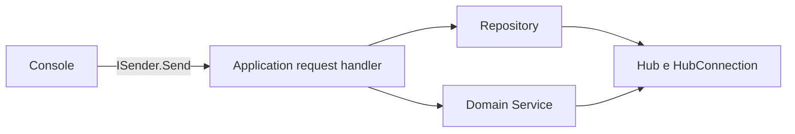

# Domain Services, strutture dati e algoritmi

Un **Domain Service** contiene una regola o un'operazione di dominio che non appartiene in modo naturale a una singola entità o value object. Qui i servizi lavorano principalmente su collezioni di `Hub`: il Domain espone le interfacce e le implementazioni, l'Application le usa nei request handler e la Console invia le richieste tramite MediatR.

## Flusso di una richiesta



Le letture dei servizi sono esposte come query. Per esempio `GetSortedHubsQuery` chiama `IHubSortingDomainService`; `FindShortestHubPathQuery` legge Hub e collegamenti dal repository e chiama `IHubGraphDomainService`. La creazione di un collegamento è un command, `ConnectHubsCommand`, perché modifica i dati.

## Regole di dominio

### Unicità del nome — `HubDomainService`

`EnsureNameIsUnique` crea prima il value object `Name`, così controlla il nome normalizzato. Poi scorre gli Hub restituiti dal repository e confronta i nomi senza distinzione tra maiuscole e minuscole. L'ID passato come esclusione permette di aggiornare un Hub mantenendo il proprio nome.

- Struttura: scansione lineare della collezione.
- Tempo: **O(n)**, con `n` Hub.
- Memoria aggiuntiva: **O(1)**.
- Usato dai casi d'uso di registrazione e aggiornamento.

### Ordinamento — `HubSortingDomainService` e `ISorter<T>`

Il domain service sceglie la chiave da ordinare: ID, nome o codice zona. Delega l'algoritmo a `ISorter<Hub>`, che riceve una funzione `Func<Hub, TKey>` per selezionare la proprietà e un comparer opzionale.

```csharp
sorter.Sort(hubs, hub => hub.Name.Value, StringComparer.Ordinal);
```

Il selettore è una lambda: il sorter non conosce la struttura di `Hub` né decide quale campo usare. L'implementazione si basa su LINQ `OrderBy`.

- Tempo: **O(n log n)**.
- Memoria aggiuntiva: **O(n)** per il risultato ordinato.
- Query: `GetSortedHubsQuery`.

### Raggruppamento — `HubGroupingDomainService`

Un `Dictionary<string, List<Hub>>` associa ogni codice zona al gruppo di Hub corrispondente. Dopo il raggruppamento, i codici zona vengono ordinati e ogni gruppo viene ordinato per ID. Il dizionario fornisce accesso medio **O(1)** alla lista associata a una zona.

- Costruzione dei gruppi: **O(n)** atteso.
- Ordinamento delle zone e dei gruppi: fino a **O(n log n)** complessivo.
- Memoria: **O(n)**.
- Query: `GetHubsGroupedByZoneQuery`.

## Collezioni della piattaforma

I servizi `HubQueueDomainService`, `HubStackDomainService`, `HubHashMapDomainService` e `HubSetDomainService` mostrano l'uso delle collezioni generiche .NET su dati di dominio.

| Struttura | Servizio | Operazione mostrata | Complessità |
|---|---|---|---|
| `Queue<Hub>` | `HubQueueDomainService` | Inserimento e rimozione FIFO: il primo Hub inserito è il primo elaborato | **O(n)** per elaborare `n` Hub; enqueue/dequeue sono **O(1)** ammortizzato |
| `Stack<Hub>` | `HubStackDomainService` | Rimozione LIFO: l'ultimo Hub inserito è il primo estratto | **O(n)** per estrarre `n` Hub; push/pop sono **O(1)** ammortizzato |
| `Dictionary<Guid, Hub>` | `HubHashMapDomainService` | Indicizzazione degli Hub per ID | **O(n)** atteso per costruirla; ricerca per chiave **O(1)** atteso |
| `HashSet<string>` | `HubSetDomainService` | Calcolo dei codici zona distinti | **O(n)** atteso |

`GetHubCollectionsQuery` invoca i quattro servizi e restituisce i risultati alla Console. La Queue conserva l'ordine ricevuto dal repository; lo Stack mostra quell'ordine al contrario. Il set usa confronto `Ordinal` sui codici zona normalizzati.

## Albero binario di ricerca

`HubTreeDomainService` costruisce un **binary search tree** usando `Hub.Id` come chiave. Per ogni nodo, gli ID minori vanno a sinistra e quelli maggiori a destra; ID duplicati non aggiungono un secondo nodo. Una visita **in-order** (sinistra, nodo, destra) restituisce gli Hub ordinati per ID.

- Costruzione: **O(n log n)** se l'albero è ragionevolmente bilanciato; **O(n²)** nel caso peggiore, quando gli inserimenti producono una catena.
- Visita: **O(n)**.
- Memoria: **O(n)** per i nodi; la ricorsione usa **O(h)** stack, dove `h` è l'altezza.
- Query: `GetHubTreeOrderQuery`.

Questa è una struttura didattica non auto-bilanciante: per grandi volumi o garanzie di prestazione si userebbe un albero bilanciato.

## Trie per prefissi

`HubTrieDomainService` inserisce nel trie i caratteri dei nomi degli Hub, convertiti in maiuscolo. Ogni nodo contiene un dizionario `Dictionary<char, TrieNode>` per gli archi verso i caratteri successivi; il nodo finale conserva gli Hub con quel nome. La ricerca percorre i caratteri del prefisso e visita poi il sottoalbero trovato.

- Inserimento: **O(L)** per nome di lunghezza `L`.
- Individuazione del prefisso: **O(P)** per prefisso di lunghezza `P`.
- Raccolta dei risultati: proporzionale ai nodi del sottoalbero; l'ordinamento finale dei `k` risultati costa **O(k log k)**.
- Memoria: proporzionale al numero di caratteri distinti nei nomi inseriti.
- Query: `SearchHubsByPrefixQuery`.

Un prefisso vuoto individua tutti gli Hub. Il confronto non distingue maiuscole e minuscole.

## Grafo degli Hub

`HubConnection` è un value object che rappresenta un arco **bidirezionale**, identificato da due ID Hub distinti e da una distanza positiva. Gli endpoint vengono normalizzati in ordine per rendere stabile l'uguaglianza dell'arco. Infrastructure salva gli archi in `data/hub-connections.json`.

`HubGraphDomainService` costruisce una lista di adiacenza: un dizionario da ID Hub alla lista dei vicini con il peso del collegamento. La lista di adiacenza occupa **O(V + E)** memoria, con `V` Hub e `E` collegamenti.

### Cammino minimo — Dijkstra

`FindShortestPath` usa Dijkstra, adatto perché `HubConnection` ammette solo distanze positive. Una `PriorityQueue<Guid, decimal>` estrae il prossimo Hub con distanza provvisoria minore; un dizionario conserva le distanze migliori e un altro registra il predecessore per ricostruire il percorso.

- Tempo: **O((V + E) log V)** con la coda di priorità.
- Memoria: **O(V + E)**, incluso il grafo e le mappe di supporto.
- Risultato: sequenza di ID Hub e distanza totale; se non esiste un percorso, il servizio restituisce `null`.
- Query: `FindShortestHubPathQuery`.

### BFS — visita in ampiezza

`BreadthFirstSearch` usa `Queue<Guid>` e `HashSet<Guid>`. Visita prima tutti i vicini a un arco di distanza dall'origine, poi quelli a due archi e così via. Il set impedisce di visitare più volte nodi raggiunti da percorsi diversi.

- Tempo: **O(V + E)** sulla lista di adiacenza.
- Memoria: **O(V)**.
- Query: `GetHubTraversalQuery` con `BreadthFirst`.

BFS trova un percorso con il minor numero di collegamenti in un grafo non pesato; per il minor chilometraggio si usa Dijkstra.

### DFS — visita in profondità

`DepthFirstSearch` usa `Stack<Guid>` e `HashSet<Guid>`. Esplora un ramo finché può, poi torna sui nodi in sospeso. I vicini sono ordinati per ID per rendere ripetibile l'ordine di visita.

- Tempo: **O(V + E)** sulla lista di adiacenza.
- Memoria: **O(V)**.
- Query: `GetHubTraversalQuery` con `DepthFirst`.

DFS è utile per esplorare componenti e raggiungibilità; non garantisce il percorso più corto.

## Backtracking: tutti i cammini semplici

`HubBacktrackingDomainService` cerca percorsi tra origine e destinazione senza ripetere un Hub nello stesso percorso. Aggiunge un nodo al percorso corrente, esplora ricorsivamente i vicini non visitati e poi rimuove il nodo per provare un'altra scelta: questo passo di ripristino è il *backtracking*.

- Il numero di cammini semplici può crescere esponenzialmente (fino a fattoriale in grafi densi); non esiste un limite polinomiale generale.
- La richiesta riceve `maximumPaths` e interrompe l'esplorazione quando raggiunge il limite.
- Memoria di ricerca: **O(V)** per il percorso e il set dei visitati, oltre ai percorsi restituiti.
- Query: `FindSimpleHubPathsQuery`.

Il limite controlla quanti risultati vengono prodotti e permette alla Console di mostrare una quantità contenuta di percorsi.

## Casi d'uso e Console

I request MediatR rendono accessibili questi servizi senza far dipendere la Console dalle loro implementazioni:

| Request | Servizio/i usati |
|---|---|
| `GetSortedHubsQuery` | Ordinamento |
| `GetHubsGroupedByZoneQuery` | Raggruppamento per zona |
| `GetHubCollectionsQuery` | Queue, Stack, HashMap e Set |
| `GetHubTreeOrderQuery` | Albero binario |
| `SearchHubsByPrefixQuery` | Trie |
| `ConnectHubsCommand` / `GetHubConnectionsQuery` | Creazione e lettura degli archi |
| `FindShortestHubPathQuery` | Dijkstra |
| `GetHubTraversalQuery` | BFS o DFS |
| `FindSimpleHubPathsQuery` | Backtracking |

La Console invia le request con `ISender.Send`; i handler recuperano gli Hub o i collegamenti dai repository e delegano l'algoritmo al servizio di dominio appropriato.
