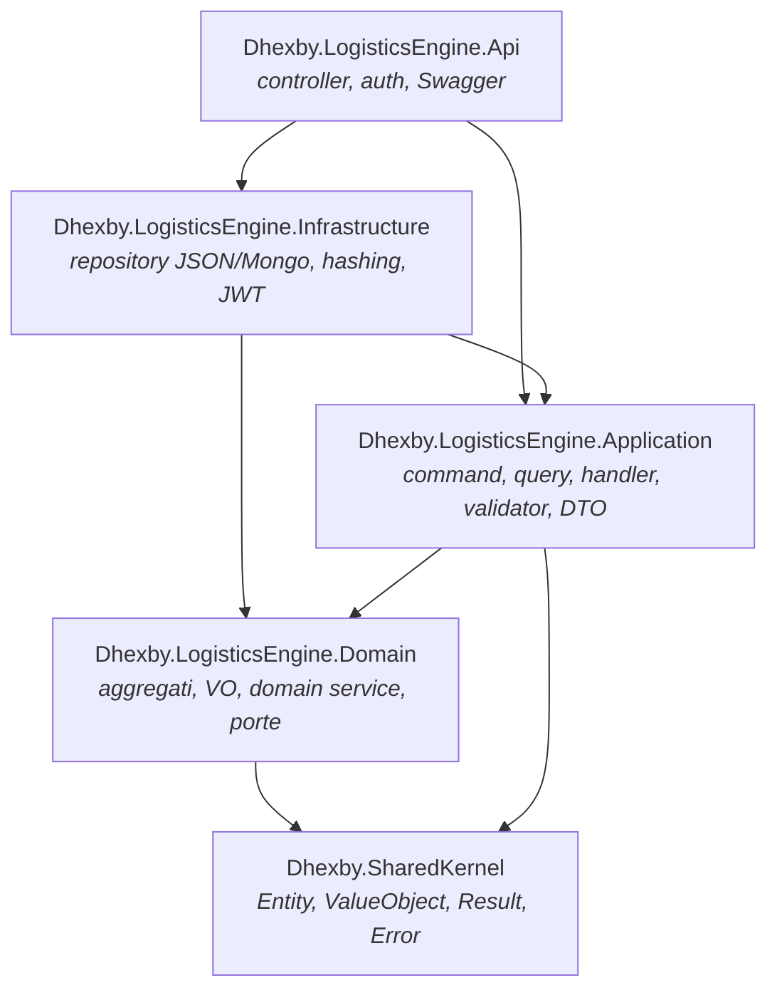
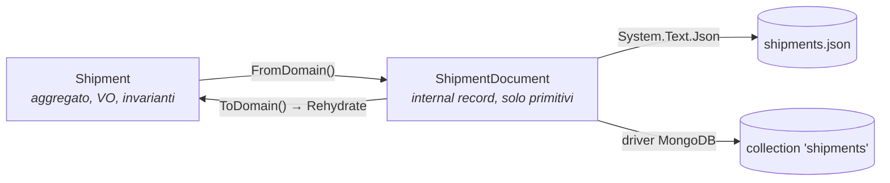
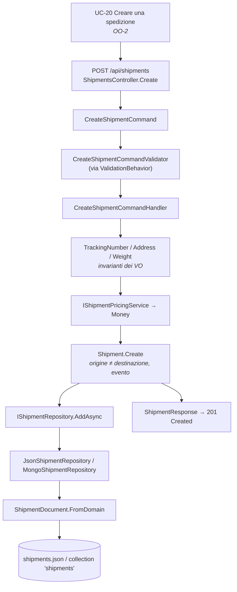

# OO — 4. Physical mapping: da OOD a OOP

Ultimo passo delle fasi OO: **dove finisce, fisicamente, ogni elemento del modello**. Il
modello di progetto ([OO-3](OO-3-ood-relationships.md)) diventa qui progetti .NET, namespace,
file `.cs`, registrazioni nel container di dipendenze, endpoint HTTP e documenti sullo store.

Il criterio di mappatura è uno solo: **un concetto = un file, collocato nel layer che ne
determina il motivo di cambiamento**. Se una classe cambia perché cambia una regola di
business sta nel Domain; se cambia perché cambia una tecnologia sta in Infrastructure.

---

## 1. Package diagram: dal layer logico all'assembly fisico



Ogni layer logico è un **assembly separato**: il compilatore diventa il custode della regola
di dipendenza. Non è possibile che un aggregato "per sbaglio" usi MongoDB, perché il Domain
non ha alcun riferimento a Infrastructure. Gli `ArchitectureTests` verificano poi le regole
che il compilatore non può esprimere (es. "i controller non usano i repository", convenzioni
di naming `*Command`/`*Query`/`*Handler`/`*Controller`).

Struttura fisica:

```
backend/src/
  Dhexby.SharedKernel/                    Entity.cs ValueObject.cs Result.cs Error.cs ErrorType.cs
                                          ValidationError.cs IDomainEvent.cs
  Dhexby.LogisticsEngine.Domain/          Shipments/ Orders/ Hubs/ Zones/ Routing/ Users/
  Dhexby.LogisticsEngine.Application/     una cartella per use case, sotto l'area di dominio
  Dhexby.LogisticsEngine.Infrastructure/  Persistence/{Common,<Area>}/ Authentication/
  Dhexby.LogisticsEngine.Api/             Controllers/<Area>/ Authorization/ Extensions/ Program.cs
backend/tests/
  Dhexby.LogisticsEngine.UnitTests/
  Dhexby.LogisticsEngine.ArchitectureTests/
```

---

## 2. Mappatura dei concetti di dominio

### 2.1 Aggregati e Value Object

| Concetto (OO-1) | Costrutto OOP | File |
|---|---|---|
| Shipment | `sealed class Shipment : Entity` | `Domain/Shipments/Shipment.cs` |
| TrackingNumber, Address, Weight, Money | `sealed class … : ValueObject` | `Domain/Shipments/{TrackingNumber,Address,Weight,Money}.cs` |
| Stato spedizione | `enum ShipmentStatus` | `Domain/Shipments/ShipmentStatus.cs` |
| Order | `sealed class Order : Entity` | `Domain/Orders/Order.cs` |
| OrderNumber, CustomerName | `sealed class … : ValueObject` | `Domain/Orders/{OrderNumber,CustomerName}.cs` |
| Priorità / stato ordine | `enum OrderPriority`, `enum OrderStatus` | `Domain/Orders/{OrderPriority,OrderStatus}.cs` |
| Hub | `sealed class Hub : Entity` | `Domain/Hubs/Hub.cs` |
| HubCode, GeoCoordinate | `sealed class … : ValueObject` | `Domain/Hubs/{HubCode,GeoCoordinate}.cs` |
| Road | `sealed class Road : Entity` | `Domain/Routing/Road.cs` |
| Zone | `sealed class Zone : Entity` | `Domain/Zones/Zone.cs` |
| Street, ZoneCode | `sealed class … : ValueObject` | `Domain/Zones/{Street,ZoneCode}.cs` |
| User, Email, ruolo | `sealed class User : Entity`, `ValueObject`, `enum UserRole` | `Domain/Users/` |
| DispatchAction | `sealed record` | `Domain/Orders/Dispatching/DispatchAction.cs` |
| RoutePath, RoadEdge, ReachabilityResult | `sealed record` | `Domain/Routing/` |

Convenzioni OOP che traducono le scelte di OOD:

| Scelta di design | Costrutto C# |
|---|---|
| Aggregato non estendibile | `sealed class` |
| Creazione controllata | costruttore `private` + `static Result<T> Create(...)` |
| Stato modificabile solo dall'interno | `public T Prop { get; private set; }` |
| Composizione difesa | `private readonly List<Street> _streets` + `IReadOnlyCollection<Street> Streets => _streets.AsReadOnly()` |
| Value Object immutabile | proprietà `{ get; }` senza setter |
| Uguaglianza per valore | override di `GetAtomicValues()` |
| Esito prevedibile | ritorno `Result` / `Result<T>` |
| Fatto avvenuto | `RaiseDomainEvent(new XxxDomainEvent(...))` |
| Ricostruzione da store | `static T Rehydrate(...)` — bypassa regole ed eventi, uso riservato ai repository |

> **`Create` vs `Rehydrate`** è il punto in cui il mapping fisico tocca la semantica: creare
> un oggetto *nuovo* è un fatto di dominio (regole + evento); ricostruire un oggetto *già
> esistente* dallo store non lo è, e rieseguire le regole (o rilanciare gli eventi) sarebbe
> sbagliato. Due metodi distinti perché sono due operazioni diverse.

### 2.2 Domain service e strutture dati

| Elemento OOD | Interfaccia | Implementazione | Struttura dati .NET usata |
|---|---|---|---|
| Pricing | `IShipmentPricingService` | `ShipmentPricingService` | — |
| Cronologia undo/redo | `IDispatchHistory` | `DispatchHistoryStack` | due `Stack<DispatchAction>` + `lock` |
| Coda di lavorazione | `IOrderProcessingQueue` | `OrderProcessingQueue` | `Queue<Order>` (FIFO su `PlacedOnUtc`) |
| Coda express | `IOrderDispatchPriorityQueue` | `OrderDispatchPriorityQueue` | `PriorityQueue<Order,(int,long)>` (min-heap su priorità negata, poi tick) |
| Grafo della rete | — (classe concreta) | `RoadNetwork` | `Dictionary<Guid, List<RoadEdge>>` (liste di adiacenza) + `Dictionary<Guid, GeoCoordinate>` |
| Ricerca di cammino | — (`internal static`) | `ShortestPathSearch` | `PriorityQueue<Guid,double>`, `Dictionary`, `HashSet` |
| Dijkstra / A\* | `IRouteCalculationService` | `DijkstraRouteCalculationService`, `SmartRoutePlanner` | riusano `ShortestPathSearch` |
| Raggiungibilità | `INetworkAnalysisService` | `NetworkAnalysisService` | `Queue<Guid>` (BFS) e `Stack<Guid>` (DFS) |
| Albero delle zone | `IZoneRepository.GetChildrenAsync` | `GetZoneTreeQueryHandler` | discesa ricorsiva per id |

Tutte queste classi stanno nel **Domain**, non in Infrastructure: sono regole logistiche
(come si smaltiscono gli ordini, come si sceglie un percorso), non dettagli tecnologici.

---

## 3. Mappatura dei casi d'uso (Application)

Ogni caso d'uso di [OO-2](OO-2-use-cases.md) è una **cartella** con tre file — il *vertical
slice*:

```
Application/Shipments/CreateShipment/
  CreateShipmentCommand.cs           record : IRequest<Result<ShipmentResponse>>   ← l'intenzione
  CreateShipmentCommandHandler.cs    IRequestHandler<TCommand, TResponse>          ← l'orchestrazione
  CreateShipmentCommandValidator.cs  AbstractValidator<TCommand>                   ← il formato dell'input
```

| Elemento OOD | Costrutto OOP | Regola |
|---|---|---|
| Caso d'uso di scrittura | `sealed record XxxCommand : IRequest<Result<T>>` | nome all'imperativo |
| Caso d'uso di lettura | `sealed record XxxQuery : IRequest<Result<T>>` | nessun effetto collaterale |
| Realizzazione del caso d'uso | `XxxHandler : IRequestHandler<,>` | un handler per richiesta, mai riusato da un altro handler |
| Validazione dell'input | `XxxValidator : AbstractValidator<>` | solo *formato*; le regole di business stanno nel dominio |
| Contratto verso il client | `sealed record XxxResponse` (DTO) | il dominio non esce mai dal confine dell'Application |
| Comportamento trasversale | `ValidationBehavior<TRequest,TResponse>` | registrato come open behavior nella pipeline MediatR |

**Perché tre file e non uno.** La coesione è per *caso d'uso*, non per tipo di artefatto:
tutto ciò che cambia insieme sta insieme. Aggiungere un caso d'uso significa aggiungere una
cartella, non modificare classi condivise.

**Perché i DTO esistono.** Restituire l'aggregato renderebbe la serializzazione parte del
contratto pubblico del dominio: qualunque rinomina di proprietà romperebbe il frontend. Il DTO
è il giunto che consente di far evolvere le due parti in modo indipendente.

---

## 4. Mappatura dell'API

| Caso d'uso | Endpoint | Controller (file) | Autorizzazione |
|---|---|---|---|
| UC-01 / UC-02 | `POST /api/auth/register`, `POST /api/auth/login` | `Controllers/Auth/AuthController.cs` | `[AllowAnonymous]` |
| UC-20 / UC-03 / UC-15 | `POST /api/shipments`, `GET /api/shipments/{id}`, `POST /api/shipments/{id}/dispatch` | `Controllers/Shipments/ShipmentsController.cs` | `ManageData` / autenticato / `Operate` |
| UC-21 / UC-04 / UC-16 / UC-08 / UC-09 | `POST /api/orders`, `GET /api/orders/{id}`, `POST /api/orders/{id}/assign`, `GET /api/orders/processing-queue`, `GET /api/orders/express-queue` | `Controllers/Orders/OrdersController.cs` | `ManageData` / autenticato / `Operate` / autenticato |
| UC-11 / UC-17 / UC-18 | `GET /api/dispatch/history`, `POST /api/dispatch/undo`, `POST /api/dispatch/redo` | `Controllers/Orders/DispatchController.cs` | autenticato / `Operate` |
| UC-22 / UC-05 | `POST /api/hubs`, `GET /api/hubs/{id}` | `Controllers/Hubs/HubsController.cs` | `ManageData` / autenticato |
| UC-23 / UC-06 / UC-19 / UC-07 | `POST /api/zones`, `GET /api/zones/{id}`, `POST /api/zones/{id}/streets`, `GET /api/zones/{id}/tree` | `Controllers/Zones/ZonesController.cs` | `ManageData` / autenticato / `Operate` / autenticato |
| UC-24 / UC-10 | `POST /api/roads`, `GET /api/roads/network` | `Controllers/Routing/RoadsController.cs` | `ManageData` / autenticato |
| UC-12 / UC-13 / UC-14 | `GET /api/routes/shortest`, `/smart`, `/reachability` | `Controllers/Routing/RoutesController.cs` | autenticato |

**Mappatura degli attori.** Gli attori di OO-2 diventano `enum UserRole` (Domain), poi un
*claim* nel token JWT, poi costanti in `Api/Authorization/Roles.cs`:

```
Roles.ManageData = "Administrator,Manager"
Roles.Operate    = "Administrator,Manager,Operator"
```

La generalizzazione fra attori del diagramma dei casi d'uso è quindi realizzata **per
enumerazione esplicita** dei ruoli ammessi, non da un meccanismo gerarchico: è più verboso ma
completamente ispezionabile leggendo un attributo `[Authorize(Roles = ...)]`.

**Mappatura degli esiti.** Un unico punto di traduzione, `Api/Extensions/ResultExtensions.cs`:

| `ErrorType` di dominio | HTTP |
|---|---|
| `Validation`, `Failure` | `400` + `ProblemDetails` |
| `NotFound` | `404` |
| `Conflict` | `409` |
| `Unauthorized` | `401` |

---

## 5. Mappatura della persistenza (object–document mapping)

Il dominio **non conosce** il formato di salvataggio: fra aggregato e store si interpone un
**modello di persistenza** fatto di soli tipi primitivi.



| Aggregato | Documento | File JSON | Collection Mongo |
|---|---|---|---|
| `Shipment` | `ShipmentDocument` + `AddressDocument` | `data/shipments.json` | `shipments` |
| `Order` | `OrderDocument` | `data/orders.json` | `orders` |
| `Hub` | `HubDocument` | `data/hubs.json` | `hubs` |
| `Zone` | `ZoneDocument` + `StreetDocument` | `data/zones.json` | `zones` |
| `Road` | `RoadDocument` | `data/roads.json` | `roads` |
| `User` | `UserDocument` | `data/users.json` | `users` |

Osservazioni sul mapping fisico:

- **Un documento per aggregato, mai per entità interna.** Le `Street` sono *dentro* il
  documento della zona (`IReadOnlyList<StreetDocument>`), coerentemente con la composizione di
  OOD; le sottozone invece sono documenti separati collegati da `ParentZoneId`, coerentemente
  con l'aggregazione. La struttura dello store rispecchia i confini degli aggregati.
- **I Value Object vengono "appiattiti"**: `Money` diventa `PriceAmount` + `PriceCurrency`,
  `Weight` diventa `WeightInKilograms`. Ricomponendoli in `ToDomain()` si passa comunque dai
  `Create` dei VO, quindi lo store non può reintrodurre valori invalidi nel modello.
- **I documenti sono `internal`**: non escono da Infrastructure, altrimenti diventerebbero un
  contratto pubblico e la libertà di cambiare storage evaporerebbe.
- **Due implementazioni per la stessa porta**: `JsonXxxRepository` (che eredita la meccanica
  file da `JsonEntityRepository<TDocument>`: `SemaphoreSlim`, read-modify-write) e
  `MongoXxxRepository` (che usa `MongoDbContext`, con serializzatori BSON registrati per
  `Guid` standard e `decimal` → `Decimal128`).

---

## 6. Composition root: dove le relazioni diventano istanze

Le relazioni di realizzazione di OO-3 esistono a runtime perché qualcuno le lega. Quel
"qualcuno" è la DI, in tre punti espliciti (`Program.cs` → `AddApplication()` /
`AddInfrastructure(configuration)`).

| Contratto | Implementazione | Lifetime | Motivo |
|---|---|---|---|
| `IShipmentPricingService` | `ShipmentPricingService` | Singleton | stateless, puro |
| `IOrderProcessingQueue`, `IOrderDispatchPriorityQueue` | `OrderProcessingQueue`, `OrderDispatchPriorityQueue` | Singleton | stateless |
| `IDispatchHistory` | `DispatchHistoryStack` | **Singleton stateful** | le pile devono sopravvivere fra le richieste — da qui il `lock` interno |
| `INetworkAnalysisService` | `NetworkAnalysisService` | Singleton | stateless |
| `DijkstraRouteCalculationService`, `SmartRoutePlanner` | tipi **concreti** | Singleton | ogni handler sceglie una strategia precisa, non "una qualsiasi" |
| `IRoadNetworkFactory` | `RoadNetworkFactory` | Scoped | dipende dai repository, vive quanto la richiesta |
| `IPasswordHasher`, `IJwtTokenGenerator` | `Pbkdf2PasswordHasher`, `JwtTokenGenerator` | Singleton | servizi tecnici senza stato per richiesta |
| `I*Repository` | `Json*` **oppure** `Mongo*` | Singleton | selezione da configurazione `Persistence:Provider` |

Il punto interessante è l'ultima riga: **la scelta dello storage è una singola `if` nel
composition root**. Nessun altro file del sistema sa quale dei due provider è attivo. È la
verifica pratica che l'inversione delle dipendenze descritta in OO-3 non è solo un disegno.

Nota sulla registrazione delle strategie di routing: sono registrate come **tipi concreti**
e non come `IRouteCalculationService`, perché due implementazioni sullo stesso contratto
renderebbero ambigua la risoluzione. `GetShortestRouteQueryHandler` chiede Dijkstra,
`GetSmartRouteQueryHandler` chiede A\*: la scelta è esplicita nel caso d'uso, che è il posto
in cui il requisito la esprime.

---

## 7. Tracciabilità end-to-end

Un esempio completo, dallo scenario utente alla riga sul disco.



| Fase OO | Artefatto | Dove vive |
|---|---|---|
| Analisi (OO-1) | concetto *Spedizione* con le sue invarianti | linguaggio del dominio |
| Analisi (OO-2) | UC-20 con scenario ed estensioni | requisiti |
| Design (OO-3) | aggregato + VO + porta + strategia di pricing | modello di progetto |
| Implementazione (OO-4) | `Shipment.cs`, `Money.cs`, `IShipmentRepository.cs`, `CreateShipment/`, `ShipmentsController.cs`, `ShipmentDocument.cs` | assembly .NET |
| Verifica | unit test di dominio e application, architecture test, gate di coverage in CI | `backend/tests/`, [ci-pipeline](2-ci-pipeline.md) |

Ogni estensione del caso d'uso ha un corrispettivo verificabile: "tracking number duplicato"
→ `ExistsByTrackingNumberAsync` → `Error.Conflict` → `409`. **La tracciabilità è il vero
prodotto delle fasi OO**: consente, partendo da una riga di requisito, di dire esattamente
quale file cambiare — e viceversa.
